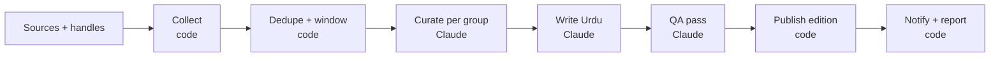

<!-- Exported from the Claude Doc "Bilingual News Digest Plan" (Plan tab) on 2026-09-23. Live copy: https://claude.ai/code/artifact/7e485eed-9c06-4459-802f-ad4361224b21 -->

# Bilingual News Digest Plan

Sep 23, 2026 · @Someone

Build it as a Next.js web app plus admin panel, fed by a Claude worker on the Lahore laptop that publishes three English + Urdu editions a day, grown out of deskboard's existing Briefing pipeline rather than started from scratch. Comparison tables and the verified source inventory sit on Research.

## What exists today

Deskboard's Briefing widget already does the hard middle of this product: it pulls about 50 RSS feeds across five topics every four hours and has Claude cluster, label and de-spin them into a bias-aware digest. Everything around that middle is missing: persistence, editions, Urdu output, a public web app, an admin panel and X handles.

The pipeline lives in the deskboard repo (`daemon/fetchers/news.py`, `daemon/fetchers/rss.py`, `web/widgets/news.js`) and runs inside the deskboard systemd user service on this laptop. Each run fetches every feed in parallel, drops items older than 24 to 30 hours, dedupes by link and title, then calls `claude -p` once per topic (Sonnet 5, tools off, JSON output) with a prompt that asks for a lead sentence and up to seven clustered stories, each with a tag (must-read, worth-knowing, skim), a coverage label (broad, partisan, single-source), a "contested" line and per-outlet framing notes. Failures fall back to raw headlines and the cost of every run is logged.

| Piece | Today (deskboard Briefing) | In the product |
| --- | --- | --- |
| Fetching | \~50 RSS feeds plus optional Firecrawl search, every 4 h during 06:00 to 24:00 | Tiered fetchers (RSS, impersonating HTTP, stealth browser) on three fixed edition times |
| Curation | `claude -p` per topic, bias-aware JSON contract with perspective labels per outlet | Same editorial contract, moved into an Agent SDK pipeline with a QA pass |
| Languages | English only (BBC Urdu is read, never written) | English and Urdu for every story and every UI string |
| Storage | One `news.json`, overwritten each run | Postgres: editions, stories, sources, handles, runs, with a full archive |
| Admin | `config.json` edited by hand | Web admin: sources, groups, handles, topics, briefs, review queue, run logs |
| X/Twitter | None | Handle watchlist per group, latest relevant posts attached to stories |
| Front end | GNOME desktop widget (WebKitGTK), six themes | Public Next.js PWA with themes, including the Buzurg elder theme |
| Urdu font | Jameel Noori Nastaleeq at 26 px; Mehr and Gulzar rejected because WebKitGTK misplaced their dots | Re-test every candidate in Chrome, Safari and Firefox; the WebKitGTK bug does not apply to the web |

What carries over unchanged: the editorial contract (perspective labels, clustering by `refs`, coverage and contested fields, framing angles) is the differentiating idea and should become the product's story schema. The stdlib RSS parser, the Google News RSS trick for wire services, per-topic parallel digests, the headline fallback and cost logging all carry over too.

What the gap to a product looks like: no archive, no notion of an edition, no "new since last edition" dedupe across runs, no Urdu writing, no story pages, no source health history, no verification pass, and configuration that only a developer can change.

## Product definition

The product is a bilingual newspaper that comes out three times a day, written by an agent from sources you choose, with every story traceable to the outlets and posts it came from. Three fixed editions are a feature, not a limitation: readers get a calm newspaper rhythm instead of an endless feed, and the archive is simply the stack of past editions.

**Editions.** Three a day on Pakistan time, proposed as Subh (07:00), Dopahar (13:00) and Shaam (19:30). Each edition has a permalink such as `/2026-09-23/subh`, a front page with one lead per group, and a "since the last edition" marker so a returning reader sees what is new. An edition is immutable once published; corrections are appended, never silently edited.

**Groups.** Configurable in the admin, shipped with Pakistan, India, Afghanistan, Middle East, Muslim World and World. A group owns its sources, its X handles, its topic keywords, an editor brief (what matters to this audience, what to skip) and a target story count. Groups can be reordered and hidden per theme, so the elder theme can show only three.

**Stories.** Each story keeps the current editorial contract: neutral title, two-to-three sentence summary with attribution, why it matters, tag, coverage label, contested line, per-outlet framing angles and the full list of source links. New fields: the matching X posts (handle, text, link, time), an Urdu title and Urdu body written for Urdu readers rather than translated word for word, a story thread id so a developing story links back to its earlier appearances, and a verification status from the QA pass.

**Archive.** Browse by date, then edition, then group. A story page aggregates every source and post behind it and links to the thread's history. Search comes later; date navigation ships first.

**Bilingual everything.** One switch (English or Urdu) applies to UI strings, dates, digits, story text and direction. The choice is remembered. Both languages are generated in the same run so the Urdu edition is never behind.

**Admin panel.** Sources (URL, kind, group, language, perspective label, active flag, health), groups and briefs, X handles per group, topic keywords, edition schedule, a review queue that can hold an edition for approval before it goes public, run logs with per-source success and cost, manual corrections, and theme defaults.

**Themes.** Classic (paper, serif headlines), Night (dark) and Buzurg (elder: big type, high contrast, one column, read-aloud). More can be added as CSS token sets.

**Readers.** Family and community readers in Pakistan and the diaspora, including elders who read Urdu more comfortably than English. No reader accounts in v1; personalization, comments and search are deliberately out of scope until the editions themselves are excellent.

**Non-negotiables.** Never invent a fact that is not in a source. Show the outlets and their leanings on every story. Disclose that the text is AI-written from listed sources. Keep the three-edition rhythm even when a breaking story tempts a fourth.

## Fetching stack and bot checks

Most sources never need a bot bypass. Aim to read 60 to 80 percent of them over RSS and escalate lazily: an impersonating HTTP client, then a stealth browser, then a hosted fetch API for the last few percent. Keep the worker in Python; its anti-bot ecosystem is far stronger than Node's, and deskboard's fetcher is Python already.

| Tier | Pick | Use it for | Why this one |
| --- | --- | --- | --- |
| 0, no scraping | `feedparser` on RSS or Atom, Google News sitemaps, Google News RSS with `gnews-decoder` for its encrypted links, Bluesky public API, YouTube channel RSS, Telegram public channel pages | 60 to 80 percent of sources | No bot risk, cheapest, honest; send `If-Modified-Since` and cache |
| 1, impersonating HTTP | `curl_cffi` (or Scrapling's `Fetcher`, which wraps it) plus `trafilatura` for article text | Article bodies and sites that block plain Python | Matches Chrome's TLS and HTTP/2 fingerprint; MIT; released 2 Sep 2026; a 21-line wrapper matched a 49-patch Chromium fork in the May 2026 benchmark |
| 2, stealth browser | Scrapling `StealthyFetcher` (Patchright underneath) headed under Xvfb with a persistent profile; fallback `zendriver`, then SeleniumBase CDP Mode with `solve_captcha()` | Cloudflare managed challenge, JavaScript-rendered pages | Best Cloudflare pass rates in independent tests; one persistent profile reuses `cf_clearance` across the three daily runs |
| 3, hosted or real browser | Firecrawl cloud (1,000 free credits a month), then Zyte API paid per successful page; a real logged-in browser only semi-manually for social profiles | The stubborn 5 to 10 percent | 50 sources times 3 runs is about 4,500 fetches a month; a 10 percent escalation is about 450 pages, inside the free tier or under 5 dollars |

A plain `httpx` or `requests` call with a Chrome user agent is worse than an honest one: Python's TLS ClientHello and HTTP/2 settings contradict the claimed browser, and Cloudflare and Akamai score that inconsistency as a bot before serving HTML.

One constraint is specific to this laptop: from Pakistani ISPs, The Hindu, Indian Express, Times of India, Scroll, The Wire, The Quint, The Daily Star, Foreign Policy, Press TV, Al Jazeera and Telegram are unreachable (DNS not found or TLS reset), while Hindustan Times, Siasat, 5Pillars and the Radio Azadi domains fail only on DNS. The fix is your Hetzner server in Germany, used per source rather than as a blanket tunnel:

- Run a SOCKS5 proxy to Germany as a user service: `autossh -N -D 127.0.0.1:1080 hetzner`. Nothing to install on the server, no sudo, no routing changes, and `socks5h://127.0.0.1:1080` resolves DNS in Germany too, which clears the DNS-only blocks in the same step. The existing WireGuard config is a full tunnel (`AllowedIPs = 0.0.0.0/0`), which would send X reads, Pakistani sites and your own browsing through a German datacenter address; keep it for reaching Hetzner services, or make a split copy limited to the tunnel subnet if you prefer WireGuard plus a small SOCKS daemon such as microsocks on the server.
- Give each source a route (`direct` or `germany`). The collector flips a source to `germany` after two direct failures with DNS not found or connection reset, and flips it back if Germany returns 403.
- Germany is for reach, never for bot evasion. Hetzner addresses are datacenter addresses and your own script notes the exit IP is already Cloudflare-blocked on at least one site. Indian Express refuses datacenter IPs outright and Al Jazeera returned 403 through a datacenter proxy during the source check, so both stay on Google News `site:` queries. Everything that passes bot checks on the laptop's residential IP, above all the X list endpoint, keeps fetching directly.
- The same route reads Telegram channel pages and can post to the Telegram Bot API.

Later, the whole collector can move to the Hetzner box and leave only the Claude judgment on the laptop; nothing in the design changes because the worker only talks to the publish API.

Operating rules for tier 2:

- Run headed via `xvfb-run -a`, one browser, sequential per host, persistent `user_data_dir`; install a desktop font set; keep timezone and locale consistent with the laptop's IP (Asia/Karachi and en-US is fine); never override the user agent in Patchright, it breaks client-hint consistency.
- One stable identity with persisted cookies passes more than rotating fingerprints. Rotating proxies with a persistent profile is a contradiction anti-bots score.
- No proxies from the home ISP at this volume. Buy 1 to 3 GB of non-expiring residential bandwidth (IPRoyal or Decodo, about 2 to 3 dollars per GB) only for geo-blocked outlets or if the ISP's CGNAT address is already flagged.
- Turnstile solver services (1.20 to 1.45 dollars per thousand) are rarely needed for reading; a clean browser on a clean IP auto-passes managed challenges.

Skip: FlareSolverr (its README admits no solver works on 2026 Cloudflare), rebrowser-patches, hrequests, tls-client, cloudscraper and rnet (stale), and nodriver (no commits since May 2026; zendriver is its maintained fork). Camoufox came back in September 2026 after a year without maintenance; try it only on DataDome sites.

The Claude in Chrome extension pauses on CAPTCHAs by design and is fingerprintable, so stealth fetching belongs in worker code, not in Claude clicking through challenges.

Legal and etiquette: Cloudflare's 15 September 2026 defaults block declared AI agents on ad-bearing pages of free-plan zones, so an undeclared stealth browser is impersonating a human; keep volume low, cache, honour robots.txt disallows and crawl delays, obey 429s, store links and short extracts rather than full text, and never circumvent paywalls. US courts (hiQ v LinkedIn 2022, Meta v Bright Data 2024) treat logged-out reading of public pages as lawful; logging in creates clickwrap exposure, so never automate a personal social account. zendriver is AGPL and Firecrawl self-hosted is AGPL, fine for an internal worker.

## X/Twitter handles

Read X through its own embed (syndication) endpoint for public Lists. Tested live on 23 September 2026, it returned about 100 fresh posts per list with no login and no cost, in a separate rate bucket from profile reads. Keep a cheap hosted scraper as the automatic fallback and pull Bluesky and YouTube for the handles that exist there. Nitter and XCancel are dead, and the official API is pay-per-use only and five to twenty times more expensive.

How it works:

1. With a dedicated X account, never a personal one, create public Lists of 20 to 25 handles each, roughly one per group, keeping high-volume outlets (ARY, NDTV, ANI) apart from low-volume journalists and politicians. 200 handles is 8 to 10 lists; 50 handles is 2 or 3. The list id goes in the admin next to the group.
2. A collector on its own systemd timer runs every 30 to 60 minutes, not just three times a day, because each list call returns only the latest 100 items. It fetches `syndication.twitter.com/srv/timeline-list/list-id/<id>` per list, five seconds apart, with a desktop user agent, parses the `__NEXT_DATA__` JSON and upserts by post id (author, text, links, time, retweet flag). That is 240 to 480 requests a day, well under the observed limit of about 50 per 15 minutes per IP.
3. The edition job reads only the local cache. Posts enter the curation prompt as numbered items beside articles, stories attach them by ref, and the site shows them as quoted cards with the original text and link, never paraphrased.
4. Health check: alert when a list returns fewer than five entries or its newest post is older than six hours on a busy list. That is the signal X has closed the endpoint.

**Fallback.** A handle silent for 24 hours, or the endpoint dying, triggers a call to twitterapi.io's last-tweets endpoint at about 0.003 dollars per handle. Worst case if the primary fails completely: about 14 dollars a month for 50 handles or 54 dollars for 200; as a gap-filler it stays under 5 dollars. Keep 20 dollars of prepaid credit loaded. SocialData is the equivalent second choice.

**Supplement.** Bluesky's public API (`getAuthorFeed`, no auth) and YouTube channel RSS, both free and risk-free. Expect them to cover 20 to 40 percent of the watchlist: outlets and liberal commentators, few politicians or Urdu television anchors. Resolve handles once and store the mapping.

**Per-profile syndication** is a freshness lottery (13 of 28 sampled handles were current, the rest frozen snapshots months or years old), so use it only behind a staleness check.

Do not rely on Nitter or XCancel (repository archived 11 September, service suspended 15 September 2026), upstream twikit (broken; twifork is the maintained drop-in), per-handle Apify actors (50-post minimum per query), browser automation across 200 profiles (daily view caps, Arkose challenges and account bans), or the official API unless the budget tolerates 240 dollars a month. Claude in Chrome is fine for reading one List page by hand but wasteful for a cron.

**Legal.** X's terms prohibit scraping without written consent and set liquidated damages of 15,000 dollars per million posts viewed in a day; the terms effective 9 October 2026 extend liability to anyone who knowingly facilitates it. Embedded timelines are an interface X publishes for third-party sites, which is the strongest argument for the syndication route, and the volumes here sit three to four orders of magnitude below the damages threshold. Hygiene: read-only, logged-out endpoints first, a throwaway account only for creating the Lists, cache by post id and never re-fetch, back off on 429, store snippets and links rather than republishing.

## The worker

Run the worker as a Python Agent SDK program under a systemd user timer on this laptop, billed to an API key, with code doing the fetching and Claude doing the judgment. Claude Code's own schedulers do not fit an always-on Fedora laptop: session cron jobs only fire while a session is open and expire after seven days, Routines run in Anthropic's cloud on a fresh clone without local files or the database, and Desktop scheduled tasks are Ubuntu and Debian only.

| Decision | Pick | Why |
| --- | --- | --- |
| Scheduler | systemd user timer, `OnCalendar=*-*-* 07,13,19:00 Asia/Karachi`, `Persistent=true`, plus `loginctl enable-linger` (currently off on this machine) | Survives reboots, runs a missed slot once after sleep, validated with `systemd-analyze calendar` here |
| Orchestration | Python `claude-agent-sdk` 0.2.158 (same engine as Claude Code 2.1.280) | In-process custom tools, schema-validated structured output, hooks for a per-tool audit log, `max_budget_usd`; keep `claude -p` for debugging |
| Permissions | `permission_mode="dontAsk"` with an explicit tool allowlist; WebSearch, WebFetch and Bash disabled | Deterministic and unattended. The built-in WebFetch returns a small model's summary rather than the page, and WebSearch runs only against Anthropic's US backend, so the worker fetches with its own code |
| Browser | The worker's own Scrapling and Patchright fetchers, headed, inheriting the GNOME session's Wayland display through `systemctl --user import-environment`; Xvfb as fallback | Claude never drives a browser in the cron path. The Claude in Chrome extension needs a visible Chrome, a claude.ai login, and pauses on CAPTCHAs |
| Billing | Console API key for the worker; the Max plan stays for interactive work | Subscription automation is allowed today, but Anthropic changed its status three times in 2026 and paused a credit scheme on 15 June; a runaway worker would also eat the weekly cap shared with your own sessions. Anthropic's help article says production automation should use an API key |
| Models | Sonnet 5 for curation, Opus 5.5 for the Urdu pass, Haiku 4.5 for QA; measure one week in dry-run mode before fixing the mix | Urdu quality is the product, so the strongest affordable model writes it; clustering and checking are cheaper judgments |

Cost, API list prices on 23 September 2026 with prompt caching, code-first pipeline of about six Claude calls per run, three runs a day:

| Model for the whole run | Per run | Per month |
| --- | --- | --- |
| Haiku 4.5 | 0.21 dollars | 19 dollars |
| Sonnet 5 | 0.43 dollars | 38 dollars |
| Opus 5.5 | 0.79 dollars | 71 dollars |
| Opus 5 | 1.06 dollars | 96 dollars |
| Fable 5.1 | 1.90 dollars | 171 dollars |

The recommended mix lands around 50 to 70 dollars a month before X costs. An agentic run that lets Claude browse for an hour costs three to four times more, which is the main reason to keep fetching in code. The token counts are modelled, not measured; one week of dry runs reading `total_cost_usd` settles it.

Laptop preparation, all one-time: enable linger, tell logind to ignore the lid switch (the default ignores inhibitors when the lid closes), set GNOME's on-AC sleep to nothing, wrap each run in `systemd-inhibit`, use `KillSignal=SIGINT` so an interrupted turn ends cleanly, lock with `flock`, and add an `OnFailure` unit that posts the last 40 log lines to ntfy or a Telegram bot. A missed heartbeat should alert too, so a silently skipped run is noticed.

Reliability rules the worker enforces in code: a run id of date plus slot so reruns are idempotent; reject any story that cites a URL not present in the input; require at least one source per story; a QA pass that sends anything below a confidence threshold to the review queue instead of the front page; a daily spend ceiling that skips a run; and a catch-up policy where a slot more than two hours late runs as a backfill without notifications.

Others who run Claude on a timer converged on the same shape: pre-fetch in code, keep Claude's input small, cap turns and budget, log every run, and treat a green run as different from a correct edition. Examples are linked on the Research tab.

## Pipeline

Code does the fetching and bookkeeping; Claude does only the judgment (clustering, writing, translating, checking). That split keeps runs cheap, testable and idempotent, and it is the same split deskboard already uses.



Each run is keyed by edition (date plus slot). Rerunning a slot overwrites its draft until it is published, so a failed run can be retried without duplicates.

1. **Collect.** For every active source, try the cheapest fetcher first: RSS or Atom, then an impersonating HTTP client for sites that block plain requests, then a stealth browser for the few that need JavaScript. X handles go through the method chosen in the X section. Everything is normalised to one item shape (source, URL, title, text or snippet, published time, language, kind: article or post) and stored with a content hash. The window is "since the previous edition" plus a two-hour overlap.
2. **Dedupe and window.** Canonicalise URLs (strip tracking parameters, Google News redirects), drop exact and near-duplicate titles, cap items per source, and attach each group's perspective labels. Optional: a small embedding pass to pre-group near-duplicates so Claude sees fewer, cleaner items.
3. **Curate per group (Claude).** Input: the numbered items with perspective labels, the group's editor brief, and the previous edition's story threads (id and title). Output: the JSON below. This is today's contract plus thread linking and attached posts. One call per group, run in parallel.
4. **Write Urdu (Claude, separate pass).** Input: the English stories, an Urdu style guide (news register, short sentences, no calques) and the glossary of names and transliterations. Output: Urdu title, summary, why-it-matters and contested line per story, plus any new glossary entries. A separate pass gives better Urdu and lets the glossary enforce consistent spellings for people and places.
5. **QA (Claude).** For each story: is every claim traceable to a listed item, do the numbers match, is the Urdu faithful to the English, is any wording loaded? Output a status per story (verified, flagged with reason). Flagged stories go to the review queue or below the fold, never silently to the front page.
6. **Publish.** Write the edition and its stories through the authenticated publish API, mark it published, trigger the web app's revalidation, snapshot the edition JSON to disk so the archive survives any database problem.
7. **Notify and report.** Send the edition to the delivery channels, then write the run log: per-source success, items collected, tokens and cost, duration, and anything flagged. A failed run pings you.

The curation contract (per group):

```json
{
  "lead": "one sentence, at most 22 words",
  "stories": [{
    "thread": "existing thread id or null",
    "ref": 12, "refs": [12, 40, 57], "posts": [3, 9],
    "title": "neutral, at most 14 words",
    "summary": "2-3 sentences with attribution",
    "why": "one sentence or empty",
    "tag": "must-read | worth-knowing | skim",
    "coverage": "broad | partisan | single-source",
    "contested": "what outlets dispute, or empty",
    "angles": [{"ref": 40, "note": "how this outlet frames it"}]
  }]
}
```

Rules that stay from today's prompt: use only what the items say, never fill gaps from memory or guess numbers, cluster the same event into one story, prefer wires and public broadcasters as the primary ref, mark at most two must-reads, skip sport, crime blotter, celebrity and opinion unless the opinion is the news.

## Data model and admin panel

Postgres holds everything the worker produces and everything the admin configures; the web app only reads published editions. Raw items are kept for 30 days so a story can always be traced back to what the agent actually saw.

| Entity | Key fields | Notes |
| --- | --- | --- |
| Group | slug, name\_en, name\_ur, order, brief, story\_count, hidden\_in\_themes | One per category (Pakistan, India, Afghanistan, Middle East, Muslim World, World) |
| Source | group, name, kind (rss, html, x, telegram, youtube), url, lang, perspective, fetcher\_tier, active, last\_ok\_at, fail\_streak | Perspective label is shown to readers; fetcher\_tier is auto-escalated when a tier keeps failing |
| Handle | group, platform (x, bluesky, telegram), handle, display\_name, role (journalist, official, outlet), active | Watched for latest relevant posts |
| Topic | group, keywords\_en, keywords\_ur, boost | Steers relevance; not a hard filter |
| Item | source, url\_canonical, title, text, published\_at, lang, content\_hash, run | Raw fetched article or post, 30-day retention |
| Edition | date, slot (subh, dopahar, shaam), status (draft, review, published), published\_at, run, snapshot\_path | Immutable after publish |
| Story | edition, group, thread, title\_en, title\_ur, summary\_en, summary\_ur, why\_en, why\_ur, tag, coverage, contested\_en, contested\_ur, angles (json), qa\_status, qa\_note, order | The editorial contract, bilingual |
| StorySource / StoryPost | story, item, is\_primary | Many-to-many links to the items behind a story |
| Thread | slug, title\_en, title\_ur, first\_seen, last\_seen | A developing story across editions |
| Glossary | term\_en, term\_ur, kind (person, place, org), locked | Enforced spellings for the Urdu pass |
| Run | edition, started\_at, finished\_at, status, model, tokens\_in, tokens\_out, cost\_usd, log\_path | One per worker execution |
| RunSource | run, source, ok, items, error, ms, tier\_used | Source health history |
| Correction | story, text\_en, text\_ur, created\_at | Appended to a published story, never overwrites |
| Setting | key, value | Schedule, default theme, notification targets |
| AdminUser | email, role (owner, editor) | Passwordless email login is enough |

Admin panel screens, in the order you will use them:

- **Sources.** Table with health dots, add or edit form (URL, kind, group, language, perspective, active), a "test fetch" button that shows what the fetcher returns, and bulk import from the current deskboard config.
- **Groups and briefs.** Reorder groups, edit the editor brief in English, set the story count, choose which themes show the group.
- **Handles.** Add X, Bluesky or Telegram handles to a group, see the last post fetched and when.
- **Topics and glossary.** Keywords per group; the glossary of names with a lock so a spelling never drifts.
- **Editions.** Calendar of editions with status; open a draft to reorder, edit, drop or unflag stories in either language; publish or hold. This is the review queue.
- **Runs.** Every run with cost, duration, per-source results and the raw log; a "run now" button for a slot.
- **Settings.** Edition times, notification channels, default theme, AI disclosure text.

The admin is part of the Next.js app behind an auth check, uses route handlers with zod validation for every write, and never exposes raw SQL or arbitrary URLs, the same contract the World-Model repo already enforces.

## Web app

Next.js App Router with TypeScript, the stack you already run in the World-Model and Code19 sites, rendered as static pages that revalidate when an edition is published. Between editions the site is effectively static, so it is fast on Pakistani mobile networks and nearly free to host.

- **Routing.** `/{locale}/` front page (latest edition), `/{locale}/{date}/{slot}` edition, `/{locale}/story/{id}` story page with every source and post, `/{locale}/archive` date navigation, `/{locale}/{group}` group view, `/{locale}/about` methodology and AI disclosure. Locale is `en` or `ur`.
- **i18n and RTL.** `next-intl` for UI strings with `ur.json` and `en.json`, `lang` and `dir` set on the root element per locale, CSS logical properties everywhere (`margin-inline-start`, not `margin-left`), Tailwind v4 which supports logical utilities natively, and `Intl.DateTimeFormat('ur-PK')` for dates. Names inside Urdu text are wrapped in `<bdi>` so English brand names do not break direction.
- **Fonts.** Self-hosted with `next/font/local`, subset to the ranges used, preloaded for the current locale only. The Urdu picks and CSS rules are in the typography section.
- **Themes.** One set of CSS custom properties per theme (colour, type scale, spacing, radius, motion) switched by `data-theme` on the root, honouring `prefers-color-scheme` and `prefers-reduced-motion` by default. Buzurg is a theme plus a layout mode (one column, hidden groups, bigger controls), not just a palette.
- **PWA.** Manifest, install prompt, service worker that caches the latest edition for offline reading, and web push for the three edition times. A native app is not needed for v1.
- **Feeds out.** RSS and JSON Feed per locale and per group, so readers can follow in their own reader and so the deskboard widget can consume the product instead of its own pipeline.
- **Share images.** Open Graph image per edition and per story generated at publish time; render Urdu ones with a headless browser rather than Satori, whose RTL and Nastaliq support is unreliable.
- **Hosting.** Vercel or Cloudflare (OpenNext) for the app, Neon or Supabase for Postgres, Cloudflare R2 or S3 for edition snapshots and images. The laptop worker talks only to an authenticated publish API, never to the database directly, so the laptop can be replaced by a server later without touching the app.
- **Accessibility baseline.** WCAG 2.2 AA everywhere, AAA in Buzurg. Keyboard navigation, visible focus, no hover-only controls, 44 px targets on mobile.
- **Analytics.** Privacy-friendly (Plausible or Umami), no cookies, so the site needs no consent banner.
- **Admin.** Same app under `/admin`, shadcn/ui components, passwordless email login, route handlers with zod.

## Urdu typography

Set headlines in Nastaliq everywhere, set body text in Nastaliq for the Classic and Night themes, and default the Buzurg theme's body to a large Naskh with a one-tap Nastaliq switch. Every font is self-hosted and licensed for commercial use, which rules out Jameel Noori Nastaleeq, the face deskboard uses today: it derives from Monotype's proprietary Noori Nastaliq, carries no licence text, and weighs 10.8 MB.

| Role | Font | Why |
| --- | --- | --- |
| Urdu headlines | Noto Nastaliq Urdu v4.000, self-hosted from GitHub, weights 400 to 700 | v4 fixed bari-ye and dot placement and is 30 percent smaller, but Google Fonts still serves v3.009 because the v4 pull request was closed unmerged; Gulzar (OFL, Regular only, repository archived April 2026) is the alternative |
| Urdu body, Classic and Night | Noto Nastaliq Urdu v4 at 22 to 24 px with line height 2.4 | The newspaper feel readers expect; Mehr Nastaliq Web is the compact alternative (53 KB, line height 1.9) but its CC BY-SA licence complicates subsetting |
| Urdu body, Buzurg default | Noto Naskh Arabic (OFL, variable, 91 KB) at 26 px with line height 1.9 | At equal size Nastaliq needs 35 percent more vertical space and its letters sit in cascades that make them effectively smaller; 9 of the 14 leading Urdu news sites, BBC Urdu included, set body in Naskh |
| Urdu UI and small text | Vazirmatn (OFL, 45 KB variable), IBM Plex Sans Arabic as alternative | Never Nastaliq under 20 px |
| English | Inter for body and UI, a serif such as Newsreader for Classic headlines | Inter's tall x-height sits well beside Naskh at a 95 percent size adjustment |

The Buzurg default is the one typography decision to validate with five real readers over 60 before launch; if they prefer the Nastaliq look at 28 px, flip the default and keep the sizes.

Rules the CSS must follow:

- `lang="ur"` on the root is not decoration: it selects the Urdu `locl` forms (digits ۴ ۶ ۷ and the Urdu ہ, ی and ک shapes) in every recommended font. The content pipeline must normalise text to the Urdu code points (ی U+06CC not ي, ک U+06A9 not ك, ہ U+06C1).
- Never set `letter-spacing` on Urdu; it breaks the joins. `word-spacing` up to 0.16 em is fine. Keep `text-align: start`, never justify. `overflow-wrap: anywhere` only on URL spans.
- Noto Nastaliq's glyphs extend 3.19 em while its line box is 2.5 em, so anything with `overflow: hidden`, `line-clamp` or a fixed height clips descenders; add `padding-block` there.
- Line heights from measured metrics: Naskh 1.7 to 1.9, Mehr 1.9 to 2.0, Gulzar 2.4 to 2.7, Noto Nastaliq 2.4 to 2.6. Set `font-synthesis: none` so single-weight Nastaliq faces are never faux-bolded.
- Load the Naskh face with `font-display: swap` and the Nastaliq face with `font-display: optional`, as BBC does, so a late Nastaliq load never reflows a page from line height 1.7 to 2.5. Preload only the current locale's body font.
- Wrap Latin names, handles and brands in `<bdi>`, use `dir="auto"` on inputs, and `unicode-bidi: plaintext` on headlines that may begin with a Latin word.

Digits and dates: `Intl.NumberFormat('ur-PK')` produces Western digits under CLDR 48; Urdu digits come from the `ur-PK-u-nu-arabext` tag. Ship digits as a reader preference, Western by default. `Intl.DateTimeFormat('ur-PK', {dateStyle: 'full'})` gives "بدھ، 23 ستمبر، 2026"; the `islamic` calendar option gives a computed Hijri date that can drift a day or two from Pakistan's moon-sighting committee, so show it as approximate or set the official date in admin settings, as deskboard's prayer widget already does. `Intl.RelativeTimeFormat('ur-PK')` gives "3 گھنٹے پہلے" for the "N hours ago" labels.

Deskboard rejected Mehr and Gulzar because WebKitGTK misplaced their dots; that is a WebKitGTK bug, and both render correctly in Chrome, Safari and Firefox. The full font table, the CSS snippet with `size-adjust` values, and what each Urdu news site loads are on the Research tab.

## Themes and the Buzurg theme

Three themes at launch, each a token set plus, for Buzurg, a layout mode. Buzurg is the theme that must be world class, so it gets a full specification here; the others follow the same token structure.

| Theme | Look | Body fonts | Notes |
| --- | --- | --- | --- |
| Classic (Akhbar) | Warm paper, serif English headlines, Nastaliq Urdu | Newsreader and Inter; Noto Nastaliq | Default; sepia variant for long reads |
| Night | Dark, off-white ink | Same faces | Follows `prefers-color-scheme`; never forced |
| Buzurg | Large, high contrast, one column | Inter; Noto Naskh with Nastaliq switch | Spec below; entrance on the home page and in settings, applied on every page |

The Buzurg specification starts from WCAG 2.2 AAA where it is cheap and from China's elder-mode rules, the only regulatory spec for this (18 pt minimum, no ads or pop-ups, fewer features, larger targets, applied on every page), plus Nielsen Norman's senior findings: bigger, simpler, higher-contrast type, no hover or pull-down menus, forgiving inputs.

**Type.** Root size 24 px, with a text-size control always visible in the top bar offering 20, 24 and 28 px, remembered per device. Latin body 24 px with line height 1.6, headline 36 px, UI 22 px, nothing under 20 px, no all-caps, no weight under 400. Urdu Naskh body 26 px with line height 1.9, headline 40 px in Nastaliq with line height 1.6, UI 24 px in Vazirmatn, nothing under 22 px. Urdu Nastaliq body, when switched on, 28 px with line height 2.4 and never below 22 px. Measure capped at 34 rem, about 55 to 60 Urdu characters, one column, start-aligned, paragraph gap 1.2 em.

**Colour.** Light: background #FAF8F5 (warm off-white, not pure white), ink #1A1A1A (about 16:1), secondary ink #3D3D3D, links #0A4A8F and underlined, red #B3261E reserved for "live", 3 px focus ring in the link colour. Dark, offered as a contrast toggle rather than a default: background #121417, ink #ECE7DE (not pure white, to avoid halation), links #8FC1FF. Both pass 7:1 for text and 3:1 for controls; `prefers-contrast: more` maps to the dark set with pure white ink.

**Layout and interaction.** Sticky top bar with three big controls: text size, read aloud, contrast. Every target at least 48 by 48 CSS px with 8 px gaps; primary buttons full width and 56 px tall on mobile; a bottom navigation of at most four items at 64 px with an icon and an Urdu label; a back-to-top button after one and a half screens; a "more news" button instead of infinite scroll; no carousels, no auto-advance, no hover-only controls, no modals except confirmations. Every story shows the date and time in words plus the relative time, and a "new since your last visit" badge from a stored timestamp. Links are underlined with 6 px separation; icons always carry a label; the theme forces `animation: none` and honours reduced motion; keyboard focus is never hidden under the sticky bars.

**Content changes, not just chrome.** Buzurg shows three groups by default (Pakistan, Muslim World, World), the "need to know" tier first, the Aasaan Urdu variant of each story (shorter sentences, a glossary), and the PDF and audio buttons before anything else.

**Read aloud.** Pre-generate one MP3 per story at publish time and stream it with paragraph highlighting. Voice: Azure `ur-PK-AsadNeural` or `ur-PK-UzmaNeural`, the only Pakistani-accent Urdu at a major cloud, at 15 dollars per million characters and a speaking rate of 0.9. Google's `ur-IN-Chirp3-HD` voices are the most natural but Indian-accented; ElevenLabs Urdu (v3 and Multilingual v2 only) costs about six times more and is worth it only for a cloned anchor voice. Budget: audio for the 15 Buzurg-visible stories per edition, about 2 million characters a month, lands near 30 dollars. The browser's own `speechSynthesis` cannot be relied on, since Urdu voices ship only on some operating systems.

**Benchmarks.** WeChat Care Mode and Toutiao's large-print edition (separate large-font app with read-aloud and a stripped interface), NHK News Web Easy for the simplified-copy-plus-audio pattern, and Safari Reader mode as the mental model. BBC Urdu is the reference for font loading, not for size; its 15 px body is far too small for readers over 60.

## Trust and world-class patterns

The best digests win on format discipline and visible provenance, not on more stories. Twelve patterns below are worth adopting directly; the full list of 22 with attributions is on the Research tab.

1. **Story anatomy in fixed sections** (Semafor's Semaform). Render every story as *What we know*, *Where outlets disagree*, *The view from Islamabad, Delhi, Riyadh, London* and *Notable coverage*. The current contract already carries these as summary, contested and angles; this is how to display them.
2. **A finishable edition** (Economist Espresso). Five top stories plus a brief per group, a total reading time, and a "you have read all of Subh" end state. Espresso's readers complain they cannot jump back to earlier days; the archive is the differentiator.
3. **A ritual masthead** (Kagi News). Gregorian and Hijri date, "Compiled 07:00 PKT from 43 sources, reviewed by \[editor\]", "updated 12 minutes ago", RSS link.
4. **Coverage chips on our own axis** (Ground News). Instead of left and right, show "covered by 9 Pakistani, 2 Indian, 0 Western outlets". A story only one side covers is a blindspot signal. This extends today's broad, partisan and single-source labels.
5. **Two tiers of depth** (1440). "Need to know": three stories with a paragraph each. "In the know": one-liners by group with source chips.
6. **A numbers strip** (Morning Brew). PKR per USD, KSE-100, gold, petrol, at the top of every edition.
7. **A named human editor** (NYT The Morning). A "reviewed by" line with a real name. It also matters legally, see below.
8. **Stories as entities with dated points** (Circa). A developing story keeps one URL and gains a dated point each edition; readers can follow it and resume where they left off.
9. **Original headline shown verbatim** beside the summary, and X posts shown as quoted cards, never paraphrased (Kagi's reputation hit came from fabricated quotes).
10. **A simplified edition** (NHK News Web Easy). "Aasaan Urdu" with shorter sentences, a glossary and slow audio, used by the Buzurg theme.
11. **Never let AI write push notifications** (Apple's January 2025 suspension after hallucinated BBC headlines). Push copy is template-based: edition name, top headline as published, nothing generated.
12. **Scope discipline** (Artifact's shutdown). It died after diluting into links, posts and social. Stay a digest.

Trust and provenance checklist for launch:

- Disclosure on every story: "Written by AI from N sources. Reviewed by \[name\]. Code19 is editorially responsible." A 2025 study found a bare "AI-generated" label lowered the credibility of true items, so pair the label with the verification statement.
- EU AI Act Article 50 applies if diaspora readers in the EU are served: AI text published to inform the public must be disclosed unless it had human review under a named editorially responsible entity. The review queue plus the named editor line satisfies this.
- Every claim links to a numbered source; an N-sources chip on every story; timestamps per story and per edition; a "since last edition" delta box.
- Confidence labels where sources conflict: "single source, unconfirmed", "disputed", "confirmed by three or more independent outlets".
- A corrections log per story, appended and dated, and a public methodology page with the full source list and every X handle watched.
- Language parity: Urdu is generated from the same fact structure and cites the same sources, never translated from the English prose.
- Machine-readable marking (schema.org and IPTC trust indicators) and real bylines, which Google requires for Google News eligibility.

## Delivery beyond the web page

In Pakistan the edition will mostly be read where it is forwarded, so the channels matter as much as the site. Ship web, Telegram, RSS and a PDF edition first; add email, a WhatsApp channel and push next; audio last.

| Channel | Fit for Pakistan | Constraints as of September 2026 | Plan |
| --- | --- | --- | --- |
| Web app (PWA) | Base | Offline caching of the latest edition | v1 |
| Telegram channel | High | Bot API fully automatable, scheduled posts, stats, 4,096-character posts; t.me is ISP-blocked in Pakistan, so post through the Germany route or the cloud publish hook, and treat Pakistani reach as VPN-dependent | v1, automated per edition and per group |
| RSS and JSON Feed | Medium | None | v1, per locale and per group |
| PDF edition | High for elders | Nastaliq must render in the PDF; generate with headless Chrome, A4 large type | v1, forwardable on WhatsApp |
| Email edition | High | RTL HTML email needs `dir` on tables; Outlook quirks; plain-text fallback | v1.1, reader picks 1, 2 or 3 editions a day or a weekly wrap |
| WhatsApp Channel | Highest | No official API; scheduling only in Android beta; no built-in analytics; followers must enable notifications | v1.1, assisted manual posting three times a day: headline, five bullets, link, edition image |
| Web push | Medium | Opt-in around 5 to 10 percent; iOS needs add-to-home-screen and a user gesture | v1.1, "edition ready" and followed-thread updates only, template copy |
| WhatsApp Business API | Medium | Opt-in, template approval, per-message pricing, 24-hour windows | v2, paid personal delivery |
| Audio edition | Medium to high | ElevenLabs Multilingual v2 is rated audiobook grade for Urdu; label as synthetic | v2, English and Urdu podcast feeds |

Publishers who moved to WhatsApp Channels report growing audiences in weeks rather than the year Telegram took, which is why the WhatsApp channel is worth the manual effort until an API exists.

## Roadmap

Four phases over about ten weeks of solo building with Claude Code, with the first public edition at the end of week 6. The worker comes first because it is the part that already half exists and the part whose cost and quality must be measured before the site is designed around them.

| Phase | Weeks | Ships | Done when |
| --- | --- | --- | --- |
| 0, decisions and setup | 1 | Name and domain; Console API key with a monthly budget; dedicated X account and public Lists; laptop prepared (linger, lid, sleep, timers); one repository with `web/`, `worker/` and `db/`; deskboard's sources imported into the Source table; glossary seeded with 100 names; an SSH SOCKS proxy to the Hetzner server in Germany as a user service, with a per-source route for the hosts blocked from Pakistan | The timer fires a no-op run three times a day and alerts on failure |
| 1, worker | 2 to 3 | Deskboard's pipeline ported into the Agent SDK with edition keys; tier 0 and tier 1 fetchers; X list collector; Urdu pass; QA pass; publish API; a bare admin that lists runs and editions; one week of dry runs with cost logged | Three editions a day land in Postgres with Urdu, sources and posts, and the measured cost is under 3 dollars a day |
| 2, web app | 4 to 6 | Edition, story, archive and group pages; English and Urdu with RTL; Classic theme; PWA with offline last edition; RSS and JSON feeds; PDF edition; Telegram channel; methodology and disclosure page; Open Graph images | First public edition published; Lighthouse accessibility 100 on the edition page in both locales |
| 3, Buzurg and channels | 7 to 8 | Buzurg theme with text-size control, read-aloud and Aasaan Urdu; test with five readers over 60; Night theme; email edition; WhatsApp channel (manual posting); web push | Five elder readers complete "find today's Pakistan news and read one story aloud" unaided |
| 4, hardening | 9 to 10 | Review queue, source health, corrections log; tier 2 stealth fetcher for the stubborn sources; Bluesky and YouTube supplements; deskboard's Briefing widget switched to consume the product's JSON feed; cost tuning | Thirty consecutive editions without a manual fix |

After that, in rough priority: audio for every story, the WhatsApp Business API tier, search across the archive, reader accounts with followed threads, and a "for you" rail that never touches the shared edition. The laptop can be replaced by the Hetzner server at any point because the worker only talks to the publish API.

## Risks, legal notes and open questions

The two risks that could stop the product are X closing its embed endpoint and Anthropic changing how automation is billed; both have a paid fallback that costs less than 60 dollars a month. Everything else is a quality or cost risk with a mitigation already in the design.

| Risk | Likelihood | Mitigation |
| --- | --- | --- |
| X closes the syndication list endpoint | Medium; it could vanish any day | Health alert on stale lists; automatic switch to twitterapi.io at 14 to 54 dollars a month; Bluesky and YouTube for the handles that exist there |
| News sites tighten Cloudflare against automated readers | Medium, rising after the September 2026 defaults | RSS keeps 60 to 80 percent of sources untouched; tier escalation per source; Firecrawl free tier and Zyte pay-per-page for the tail |
| Urdu quality drifts or names are spelled inconsistently | High without controls | Locked glossary injected into every Urdu pass; QA pass; named editor reviews flagged stories; five-reader test before launch |
| A story states something no source said | Low per story, certain over time | Reject any citation not in the input; require a source per story; QA confidence threshold; corrections log; never AI-written push copy |
| Laptop offline (power, ISP, sleep) | High in Lahore | `Persistent=true` timers, catch-up policy, missed-heartbeat alert; the worker can move to the Hetzner server unchanged |
| Anthropic changes subscription automation rules again | Medium; changed three times in 2026 | Worker on an API key with a monthly budget cap, isolated from the Max plan |
| Telegram blocked in Pakistan | Certain | Post from the cloud publish hook; WhatsApp channel and PDF are the Pakistani reach |
| Font licensing | Certain if Jameel Noori is embedded | OFL fonts only; Mehr only with counsel on share-alike |
| Legal exposure from scraping and reuse | Low at this volume | Snippets and links only, logged-out endpoints, no personal accounts, robots.txt and rate limits honoured, public methodology page |
| Cost creep | Medium | Daily spend ceiling in the worker, per-run cost in the admin, one dry-run week before each model change |
| EU AI Act if diaspora readers are served | Low | Disclosure line with a named editor and human review of flagged stories |
| Indian and some Middle East hosts unreachable from Pakistani ISPs | Certain today | Per-source SOCKS route through the Hetzner server in Germany, which also resolves DNS there; Google News site queries for Indian Express and Al Jazeera, which block datacenter IPs |

Decisions only you can make:

- [ ] Name: Teen Pehr (recommended), Sarnama or Nashriyat; confirm the .pk at PKNIC before anything else.
- [ ] Edition times: 07:00, 13:00 and 19:30 Pakistan time are proposed.
- [ ] Buzurg body default: Naskh (recommended by the evidence) or Nastaliq (the familiar look); decide after the five-reader test.
- [ ] Publishing policy: auto-publish with flagged stories held (recommended) or hold every edition for approval.
- [ ] Groups at launch: the six proposed; keep deskboard's AI, robotics and science topics as a private "Tech" group or leave them in deskboard only.
- [ ] Billing: API key for the worker (recommended) or the Max plan's setup token.
- [ ] Hosting: Vercel or Cloudflare for the app; Neon or Supabase for Postgres.
- [ ] The named human editor on every story's disclosure line.
- [ ] Urdu digits: Western by default (CLDR) or Urdu digits, at least for Buzurg.
- [ ] Landing language: Urdu first or English first for a new visitor.

## Sources

Pages actually opened during the research on 23 September 2026. Each Research tab section carries its own fuller list; these are the ones the decisions above rest on.

- Fetching: [Patchright, nodriver and curl\_cffi benchmark, May 2026](https://ianlpaterson.com/blog/anti-detect-browser-benchmark-patchright-nodriver-curl-cffi/), [Scrapling](https://github.com/D4Vinci/Scrapling), [curl\_cffi releases](https://github.com/lexiforest/curl_cffi/releases), [Patchright](https://github.com/Kaliiiiiiiiii-Vinyzu/patchright), [zendriver](https://github.com/cdpdriver/zendriver), [SeleniumBase CDP Mode](https://seleniumbase.io/examples/cdp_mode/ReadMe/), [FlareSolverr README](https://github.com/FlareSolverr/FlareSolverr), [Firecrawl pricing](https://www.firecrawl.dev/pricing), [Zyte pricing](https://www.zyte.com/pricing/), [Cloudflare's agent defaults](https://blog.cloudflare.com/content-independence-day-ai-options/), [Claude in Chrome docs](https://code.claude.com/docs/en/chrome), [CHEQ on detecting the extension](https://cheq.ai/blog/the-cyborg-session-reversing-detecting-claude-ai-agent-chrome-extension/).
- X: [X API pricing](https://docs.x.com/x-api/getting-started/pricing), [Nitter and XCancel shutdown, TechCrunch](https://techcrunch.com/2026/09/15/nitter-and-xcancel-are-dead-again-after-xs-latest-legal-actions/), [twscrape](https://github.com/vladkens/twscrape), [twitterapi.io](https://twitterapi.io/), [Bluesky getAuthorFeed](https://docs.bsky.app/docs/api/app-bsky-feed-get-author-feed), [X terms of service](https://x.com/en/tos), live probes of syndication.twitter.com from this laptop.
- Worker: [Claude Code headless](https://code.claude.com/docs/en/headless), [CLI reference](https://code.claude.com/docs/en/cli-reference), [scheduled tasks](https://code.claude.com/docs/en/scheduled-tasks), [routines](https://code.claude.com/docs/en/routines), [Agent SDK Python](https://code.claude.com/docs/en/agent-sdk/python), [structured outputs](https://code.claude.com/docs/en/agent-sdk/structured-outputs), [model pricing](https://platform.claude.com/docs/en/about-claude/pricing), [Agent SDK with a Claude plan](https://support.claude.com/en/articles/15036540-use-the-claude-agent-sdk-with-your-claude-plan), [ai-digest-cron](https://github.com/ManaalP/ai-digest-cron), [agent-cron](https://github.com/T0UGH/agent-cron).
- Typography: [Noto Nastaliq releases](https://github.com/notofonts/nastaliq/releases), [the unmerged v4 pull request](https://github.com/google/fonts/pull/7950), [Gulzar](https://gulzarfont.org/), [Mehr Nastaliq Web](https://mehrtype.com/product/mehr-nastaliq-web/), [Nafees licence](https://www.cle.org.pk/software/license/Nafees_Nastaleeq_License.html), [Hussaini Nastaleeq](https://github.com/aliftype/hussaini-nastaleeq), [Vazirmatn](https://github.com/rastikerdar/vazirmatn), [BBC Reith Qalam](https://github.com/bbc/simorgh/issues/8754), [W3C Arabic layout requirements](https://www.w3.org/TR/alreq/), [WCAG 2.2 target size](https://www.w3.org/WAI/WCAG22/Understanding/target-size-enhanced.html), [NN/g seniors](https://www.nngroup.com/articles/usability-seniors-improvements/), [Azure Urdu voices](https://learn.microsoft.com/en-us/azure/ai-services/speech-service/language-support?tabs=tts), [Google Chirp 3 HD](https://docs.cloud.google.com/text-to-speech/docs/chirp3-hd), [ElevenLabs models](https://elevenlabs.io/docs/overview/models).
- Product: [Semaform](https://www.semafor.com/article/10/18/2022/what-is-a-semaform-anyway-and-why-should-you-care), [Kagi News](https://blog.kagi.com/kagi-news), [Ground News rating system](https://ground.news/rating-system), [Particle](https://techcrunch.com/2024/11/12/particle-launches-an-ai-news-app-to-help-publishers-instead-of-just-stealing-their-work), [Artifact shutdown](https://techcrunch.com/2024/01/18/why-artifact-from-instagrams-founders-failed-shut-down/), [Apple Intelligence news pause](https://www.axios.com/2025/01/17/apple-ai-news-alerts-fake-headlines), [EU AI Act Article 50](https://artificialintelligenceact.eu/transparency-rules-article-50/), [Commission transparency guidelines](https://digital-strategy.ec.europa.eu/en/policies/guidelines-ai-transparency-obligations), [AI-label credibility study](https://www.eurekalert.org/news-releases/1118576), [China's elder-mode specification](https://www.thepaper.cn/newsDetail_forward_12083101), [WhatsApp Channels for publishers](https://www.twipemobile.com/strategies-news-publishers-use-on-whatsapp-channels-for-audience-engagement/), [WhatsApp Business API pricing](https://blueticks.co/blog/whatsapp-business-api-pricing-2026).
- Sources: every feed URL on the Research tab was fetched directly on 23 September 2026; [GDELT DOC 2.0](https://blog.gdeltproject.org/gdelt-doc-2-0-api-debuts), [Google News link decoding](https://github.com/mohamidi74/gnews-decoder), news API pricing pages linked in the Research tab.
- Local: the deskboard repository (`daemon/fetchers/news.py`, `web/widgets/news.js`, `config.example.json`), `claude --version`, `systemd-analyze calendar`, installed font files under `~/.local/share/fonts`.
