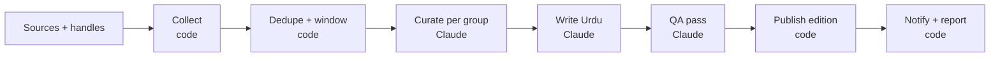

<!-- Exported from the Claude Doc "Bilingual News Digest Plan" (Plan tab) on 2026-09-23. Live copy: https://claude.ai/code/artifact/7e485eed-9c06-4459-802f-ad4361224b21 -->

# Bilingual News Digest Plan

## Decisions of 29 September 2026 (they override anything below, D1–D6 included)

The owner's second batch, after testing the first build. Schema: migration `0005_feedback_jobs_manual`
(`web/db/schema.ts`); the worker job contract is in `docs/API.md` § Jobs. D14 came later the same day, with migration
`0006_review_state`.

- **D14 Publish first, review whenever (owner, 29 September 2026).** "Don't wait for the reviewer. Publish every edition
  by default with a 'not reviewed' tag; a reviewer reviews whenever, and the story is then marked reviewed." This
  replaces the hold rule everywhere below (flagged stories no longer keep an edition off the site).
  - **Publishing.** `settings.publish_policy` gains `publish`, the new default (seed, and existing databases still on the
    old default `auto` were moved to it by migration 0006 / `db/backfill.ts`; an explicit `hold` stays): the edition
    publishes as soon as the worker finishes, even when QA flagged stories. `auto` (hold only if a story is flagged)
    and `hold` (hold every edition) remain selectable in Admin → Settings. An edition already held (status `review`)
    is still published with the edition page's Publish button, as before. The publish response now carries
    `stories` and `flagged` (docs/API.md), and the notifications say how many flagged stories await review; a
    backfill still sends no success notification.
  - **Review state per story, metadata only.** `stories.reviewed_at`/`reviewed_by` (an editor marked it reviewed;
    an owner can undo) and `withdrawn_at`/`withdrawn_by` with `withdraw_note_en`/`_ur` (the editors withdrew it,
    with a reason in at least one language; an owner can undo). The story's text is never touched: it stays as
    published, and corrections remain appended rows. Stories published before D14 stay "not reviewed". Every change
    is in `audit_log`.
  - **Readers** (`components/review-badge.tsx`, `lib/review-state.ts`, `lib/review-text.ts`). Each AI-written story
    card has a calm pill: "Not reviewed yet" / "ابھی ادارتی جائزہ نہیں ہوا", or when QA flagged it and nobody has
    reviewed it "Check raised a question" / "خودکار جانچ میں سوال اٹھا", or "Reviewed" / "جائزہ شدہ". The story page
    gives the full line ("Not yet reviewed by an editor" or "Reviewed by <name> · <date, time>") and, for a flagged
    story, the automatic check's note in plain words ("An automatic check noted: …"; after review "An automatic check
    had noted: … An editor has since reviewed the story."), never hidden. The edition header says "N of M stories
    reviewed by an editor". Feeds (a category and the line; `_review` in JSON Feed), the print sheet, the
    self-contained HTML download and the offline copies (the manifest gives each kept page a review token, so a
    story reviewed after it was kept is fetched again) show the same. An editor's manual entry (D12) carries no
    review state: its own tag and disclosure say an editor wrote it, and the header then counts "AI-written" stories.
  - **Withdrawn stories** leave the edition page, the section and topic pages, the Editor's desk, feeds, search,
    downloads, the Saved shelf, offline copies (the manifest's `drop` list deletes them from the device) and the X
    board's story links; their images are no longer served. The story's address shows only "This story was
    withdrawn by the editors" / "ایڈیٹرز نے یہ خبر واپس لے لی ہے", the date and the note, never its text or title.
  - **Disclosures.** The site-wide footer no longer claims AI authorship or human review for every story: "Stories are
    written by AI from the listed sources, except those marked as manual entries, which an editor wrote. Each
    AI-written story shows whether an editor has reviewed it yet. Every claim links to its source." (Settings
    `disclosure_en`/`_ur`; the old shipped text was replaced only where it was unchanged). Each AI story carries its own
    line, "Written by AI from N sources. <review line>. Every claim links to its source."; a manual story keeps its
    editor disclosure and nothing on its page says it was written by AI. `editor_name` is now "Editor in charge:
    <name>" in the footer, never a claim that this person reviewed every story.
  - **Admin → Review** (`/admin/review`, editors and owners; `lib/admin/review.ts`): the published AI-written stories
    nobody has reviewed, grouped by edition (newest first), flagged first, each with its QA note, sources, both
    languages and image. Actions: Mark reviewed (one story, or all shown for an edition), Add correction (the existing
    correction flow), Withdraw story (a reason in English and/or Urdu, then a confirm box); owners can undo a review
    or a withdrawal (tabs "Reviewed" and "Withdrawn"). The nav and the dashboard show how many stories await review
    and how many of them were flagged. A published edition's admin page shows each story's review state and can
    withdraw it too (manual stories included).

- **D7 Filter menus that work everywhere.** On `/ur/search` in the Kaghaz palette the native `<select>` for the group
  ("شعبہ") opened a blank white list with only the highlight bar showing. The root cause is fixed for every `<select>`
  on the reader site and in the admin, in every palette (light and dark), in Wazeh and in both directions. Wazeh
  discourages pull-down menus (see the Wazeh specification below), so in Wazeh, and wherever it reads better, the
  search filters may be accessible chip or radio groups instead.

  Done: the open list of a native `<select>` is drawn by the browser outside the page, from the select's colours,
  each option's own colours and the desktop's menu colours; on the owner's dark GNOME desktop it lost its text.
  The page no longer depends on that popup: every `option` and `optgroup` carries the palette's paper and ink
  (so an engine that draws a native list copies a readable pair), Chrome and Edge 135+ draw the list inside the
  page (`appearance: base-select`, palette colours, page fonts and direction, Wazeh-sized rows), and the reader
  site's search filters (section and topic) are chip radio groups (`components/choice-group.tsx`, `.choices`),
  so the reader site has no `<select>` left; the admin keeps its selects with the same styling.
- **D8 Relevance feedback, not approval.** Every story has two clearly labelled buttons, "Relevant to me" /
  "مجھ سے متعلق" and "Show less like this" / "ایسی خبریں کم", never bare thumbs that read as approving or disapproving
  the event. One vote per reader per story, changeable and removable (`story_feedback`, value 1 or -1). "Show less"
  offers optional reasons: topic, outlet, too much of this, not for me (`topic`, `outlet`, `too_much`, `not_for_me`).
  A separate "Report a mistake" / "غلطی کی نشاندہی" sends free text to an editors' queue (`story_reports`: open,
  resolved, dismissed); it is not a vote. The data feeds Insights, a per-reader interest profile, and later a personal
  "For you" ordering that may reweight topics and groups only: it never hides a story from the shared edition and never
  personalises away an outlet's perspective. No personal ranking ships yet.
- **D9 Full Urdu translation on request (the one exception to "snippets and links").** The owner chose a full
  translation over a condensed one. On a story's source list, each cited item not in Urdu offers "Read the full
  article in Urdu" / "پورا مضمون اردو میں". The first request queues a `translate_article` job; the worker fetches the
  full article (robots.txt, 429 cooldowns, one request per host, the source's route; a paywalled, robots-disallowed
  or unreachable article gives "could not get the full text, here is the link", never a bypass), extracts the text,
  translates it faithfully and completely into Urdu (news register, the locked glossary for names, Urdu code points),
  runs a cheap faithfulness check (numbers, names, quotes, nothing added or dropped) and stores it
  (`article_translations`, one per item). Later readers get the stored translation at once. It is shown only to
  signed-in readers, inside Tabayyun, on its own page, labelled "AI translation of <outlet>'s article · may contain
  errors" with the original link and date; never in feeds, downloads, search or the X board. Each reader has a daily
  request limit (new translation work their requests made since local midnight; setting `translate_daily_limit`,
  10 by default, editable under Admin → Settings; editors and owners get at least 25), and translation usage counts
  toward the daily usage budget (D13).
- **D10 X board.** A reader page, "X board" / "ایکس بورڈ", shows recent posts from the watched handles (X and Bluesky,
  with a platform badge) in per-group tabs, ranked by relevance to the latest published edition (entity, keyword and
  topic matches), then engagement and recency; replies and bare reposts are de-emphasised. Text verbatim, author, time,
  a link to the original, and a link to the story when a post is cited; never paraphrased; no images from posts.
  `teenpehr collect-x` (every 30 minutes) reads the X Lists and, since this batch, every watched Bluesky account
  through Bluesky's public API (no login, one account at a time, a 429 stops the rest until the next run). A post an
  approved X List carried is filed under that list's group even when its author is not a watched handle
  (`posts.raw.x_list_id`), so an approved public list's members show on the board and reach the edition. The
  owner asked for existing public X Lists per group: they are researched and verified live through the syndication
  list endpoint and written as proposals (`x_list_proposals`) for approval. Nothing writes list ids into
  `groups.x_list_ids` except an owner's "Add to group" in the admin.
- **D11 Coverage from every legitimate technique.** Verify and activate every seeded source that works (62 of 182
  were active; all 43 YouTube channels were off), add missing top publishers per group with verified feeds, Google
  News `site:` and topic queries for wires without RSS (Reuters, AP, AFP), publishers' Google News sitemaps (source
  kind `sitemap`), the GDELT DOC API as a discovery kind (`gdelt`) if it works live, YouTube channel feeds and
  Bluesky. Telegram only where reachable: it is blocked from Pakistan without the Germany route, so such sources are
  marked "needs germany". Within the etiquette: RSS first, robots.txt, one request per host, no stealth.

  Done on 29 September 2026 (details and every table in `docs/RESEARCH.md` § Coverage audit): each seed row in
  `web/db/seed/sources.json` carries the result of a live check by the worker's own reader
  (`python -m teenpehr.fetch.audit`), and `npm run sources:apply` activates a source only when its check is `ok`
  (a passing failure such as a 429 or a timeout leaves an existing row as it is). The dev database went from 62
  active of 182 sources to 253 active of 271 (after the review: seven rows that answer directly moved off the
  Germany route, both AFP sources now search AFP's own site rather than any outlet mentioning AFP, a sitemap's
  links must be on the publisher's own site, which turned Bol News off, and Malay Mail World stays off by
  choice): 89 new sources (31 RSS, 15 news sitemaps, 29 Google News `site:`
  queries, 11 YouTube channels, 3 GDELT), 11 existing rows fixed (a moved URL, a dead feed replaced by the
  publisher's news sitemap, a route or language corrected), 41 of the 43 seeded YouTube channels switched on (two
  are dormant), and 14 Bluesky outlet accounts added to `handles.json`. Still off: hosts that reset connections
  from Pakistan (The Hindu, Times of India, ThePrint, The Quint, Newslaundry, Siasat, 5Pillars, The Daily Star, Al
  Jazeera's RSS; each has a Google News or other replacement except Siasat's English site and 5Pillars), +972
  Magazine's feed (a Cloudflare challenge), two dormant YouTube channels, ReliefWeb's empty feed and the three
  GDELT sources. GDELT answered HTTP 429 to
  single requests 15 minutes apart from this connection all morning, so it is implemented but unverified (its
  sources stay off until an audit reads them). The public X Lists found (Dawn's Pakistan journalists, the NYT's
  foreign correspondents and others) exist only as old owner/slug addresses; the syndication endpoint serves list
  ids but answered 429 to every slug request, so none of them could be verified until an owner copies the numeric
  ids while signed in to x.com and runs `python -m teenpehr.fetch.xlist_audit` (see § Coverage audit). One list
  found by its id, the Financial Times' "FT journalists", was verified live and is the one proposal in
  `x-list-proposals.json` (World), awaiting the owner's decision. Telegram times out on connect from Pakistan: needs germany. The
  curation list per group (120 articles) is now filled round robin over the group's feeds when it would overflow,
  so a source late in the list is not cut entirely.
- **D12 Editors can add a story by hand.** Editors and owners only, logged (`audit_log`). The link is required
  (http/https; fetched once server-side through the SSRF-safe public fetch to confirm it exists and prefill title,
  description and image; the site's robots.txt is read first, and a page it disallows, or a site that answers 429,
  is not fetched: the editor may still add it as an unchecked link, with nothing prefilled); then title, summary, optional why it matters, optional contested line, group, tag, and an
  optional image (an upload, re-encoded and stripped like I2, or "use the article's image", a `story_image` job), in
  English and/or Urdu. A missing language is filled by the worker from the editor's text only, no new facts
  (`fill_language` job), and marked (`stories.language_filled`). Every manual story is tagged "Manual entry · added by
  <name>" / "دستی اندراج · <name>" and carries its own disclosure line (written by an editor, not AI); its link is its
  cited source (an item under a matched or new inactive `manual` source, so citations stay real), and it is never
  AI-verified (`qa_status` `manual`). Per entry the editor chooses:
  - **add to an edition** (`placement` `edition`): the upcoming edition or a held one; it is published with it, and
    worker reruns keep it (the edition PUT replaces only `origin` `ai` stories);
  - **publish now** (`placement` `desk`): it goes live at once in an "Editor's desk" strip on the front page and joins
    the next edition that publishes.

  How the Editor's desk works (`web/lib/desk.ts`): every story still belongs to an edition row, so reader queries keep
  their shape. A desk story is hosted in the upcoming unpublished edition's row; `stories.desk_at` is when it went
  live, and from then on it is immutable like a published story. The strip lists desk stories whose edition is not yet
  published. When any edition publishes, every live desk story in another unpublished edition moves into it, so it
  joins whichever edition publishes next, even when a slot is skipped or a held edition is released first. A manual
  story is not ready while it misses a language or while a `fill_language` or `story_image` job for it is queued or
  running: a desk story goes live only when ready, and an edition that publishes while one of its manual stories is
  not ready sends that story on to the upcoming edition instead of publishing it half-made.
- **D13 Daily usage budget 12.** `DAILY_BUDGET_USD` (API-equivalent dollars on the subscription) defaults to 12, up
  from 6, to make room for translations and manual-story jobs, which count toward it.

## Decisions of 28 September 2026 (they override anything below)

The owner made six decisions after the first build. The rest of this document is kept as the history of how
the product was planned; statements the decisions made wrong have been corrected in place.

- **D1 Name: Tabayyun (تبیُّن).** Seeking clarity, verification: from Quran 49:6 (al-Hujurat), "…fa-tabayyanū
  (فَتَبَيَّنُوا)…", "if a news-bearer brings you a report, verify it". Tagline: "Verify before you believe" /
  "خبر کی تحقیق کر لیا کرو". The About page shows the verse in Arabic (`lang="ar"`, Noto Naskh Arabic, never
  Nastaliq) with its reference and an explanation of the name. Only reader- and operator-visible branding changed:
  the Python package and CLI (`teenpehr`), systemd unit names, the database name and localStorage keys stay.
- **D2 Invite-only.** The whole site is behind a login wall. Roles: owner (everything, including accounts), editor
  (admin and newsroom), reader (reads the site). No public sign-up: owners send single-use invite links (the first
  owner's comes from `npm run user:invite`). The worker API (`/api/worker/*`, bearer token) stays outside the wall.
  The shared `ADMIN_PASSWORD` is retired for real accounts (`users`, `sessions`, `invites`; `web/lib/auth/`).
- **D3 Saving.** Each reader has a Saved shelf of stories and whole editions; an edition downloads as a
  print-to-PDF page and as one self-contained HTML file, and the whole shelf as one HTML file; the latest editions
  and everything saved read offline (service worker).
- **D4 Themes.** The large-type reading mode formerly called "Buzurg" is **Wazeh** (واضح, clear): a mode that
  combines with any colour palette, never described in terms of age. Palettes: classic, night, kaghaz (sepia paper),
  sabz (soft green), chandni (moonlit blue-grey dark), shab (pure black, OLED), plus "system" (classic or night by
  `prefers-color-scheme`). Every palette passes WCAG 2.2 AA for text; Wazeh with high contrast passes AAA.
- **D5 Keep everything.** Every fetched item is kept forever (no 30-day retention) with metadata for trend
  analysis, topic research and search: feed metadata on items, headline revisions, which items each run saw,
  post metadata, story keywords, topics, countries, places, event types and entities, every Claude call's output,
  and a log of reader searches. Postgres full-text search (English stemmed, Urdu `simple`) and trigram indexes
  cover stories, items and entities.
- **D6 Publisher images.** A story may show one photo, only from an item or X post it cites (primary first, then
  other cited items; a cited post's first image); never for uncited items, never AI-generated, and never with
  AI-written captions or alt text (alt is the publisher's og:image:alt or media description, else "Image from
  <outlet>" / "<outlet> کی تصویر"). Every image carries "Image: <outlet>" / "تصویر: <outlet>" linking to the
  cited article. The worker downloads it once through its Fetcher (host lock, route, SSRF guard, robots.txt, 429
  cooldown, about 8 MB cap, image types only, no SVG), strips metadata, converts to sRGB, re-encodes WebP at 480
  and 960 px (never upscaled) and uploads it (`POST /api/worker/images`); the site stores the files under
  `MEDIA_DIR` and serves them only to signed-in readers (`/media/…`), never hotlinking the publisher. A cheap
  vision check (Haiku through Claude Code) drops placeholders and logos (and images reused across a source's
  items in a run, and ones under about 300 px wide) and flags graphic images, which are blurred behind "Sensitive
  image — tap to show" / "حساس تصویر — دیکھنے کے لیے ٹیپ کریں" and hidden in Wazeh until tapped; a failed check
  counts as graphic. Each check's verdict (or why there was none) is kept as a run output, stage `image`.
  Readers choose images auto/on/off (auto is off when the device asks to save data); editors
  can hide a story's image, on a published story too (who and when are kept; the text stays immutable), and a
  hidden image's files are no longer served to readers.
  Editions published before images are not back-filled; snapshots carry image metadata.

Sep 23, 2026 · @Someone

Build it as a Next.js web app plus admin panel, fed by a Claude worker on the Lahore laptop that publishes three English + Urdu editions a day, grown out of deskboard's existing Briefing pipeline rather than started from scratch. Comparison tables and the verified source inventory sit on Research.

## What exists today

Deskboard's Briefing widget already does the hard middle of this product: it pulls about 50 RSS feeds across five topics every four hours and has Claude cluster, label and de-spin them into a bias-aware digest. Everything around that middle is missing: persistence, editions, Urdu output, a public web app, an admin panel and X handles.

The pipeline lives in the deskboard repo (`daemon/fetchers/news.py`, `daemon/fetchers/rss.py`, `web/widgets/news.js`) and runs inside the deskboard systemd user service on this laptop. Each run fetches every feed in parallel, drops items older than 24 to 30 hours, dedupes by link and title, then calls `claude -p` once per topic (Sonnet 5, tools off, JSON output) with a prompt that asks for a lead sentence and up to seven clustered stories, each with a tag (must-read, worth-knowing, skim), a coverage label (broad, partisan, single-source), a "contested" line and per-outlet framing notes. Failures fall back to raw headlines and the cost of every run is logged.

| Piece | Today (deskboard Briefing) | In the product |
| --- | --- | --- |
| Fetching | \~50 RSS feeds plus optional Firecrawl search, every 4 h during 06:00 to 24:00 | Tiered fetchers (RSS, impersonating HTTP, stealth browser) on three fixed edition times |
| Curation | `claude -p` per topic, bias-aware JSON contract with perspective labels per outlet | Same editorial contract, moved into an Agent SDK pipeline with a QA pass |
| Languages | English only (BBC Urdu is read, never written) | English and Urdu for every story and every UI string |
| Storage | One `news.json`, overwritten each run | Postgres: editions, stories, sources, handles, runs, with a full archive |
| Admin | `config.json` edited by hand | Web admin: sources, groups, handles, topics, briefs, review queue, run logs |
| X/Twitter | None | Handle watchlist per group, latest relevant posts attached to stories |
| Front end | GNOME desktop widget (WebKitGTK), six themes | Invite-only Next.js PWA with colour palettes and the Wazeh large-type reading mode |
| Urdu font | Jameel Noori Nastaleeq at 26 px; Mehr and Gulzar rejected because WebKitGTK misplaced their dots | Re-test every candidate in Chrome, Safari and Firefox; the WebKitGTK bug does not apply to the web |

What carries over unchanged: the editorial contract (perspective labels, clustering by `refs`, coverage and contested fields, framing angles) is the differentiating idea and should become the product's story schema. The stdlib RSS parser, the Google News RSS trick for wire services, per-topic parallel digests, the headline fallback and cost logging all carry over too.

What the gap to a product looks like: no archive, no notion of an edition, no "new since last edition" dedupe across runs, no Urdu writing, no story pages, no source health history, no verification pass, and configuration that only a developer can change.

## Product definition

The product is a bilingual newspaper that comes out three times a day, written by an agent from sources you choose, with every story traceable to the outlets and posts it came from. Three fixed editions are a feature, not a limitation: readers get a calm newspaper rhythm instead of an endless feed, and the archive is simply the stack of past editions.

**Editions.** Three a day on Pakistan time, proposed as Subh (07:00), Dopahar (13:00) and Shaam (19:30). Each edition has a permalink such as `/2026-09-23/subh`, a front page with one lead per group, and a "since the last edition" marker so a returning reader sees what is new. An edition is immutable once published; corrections are appended, never silently edited.

**Groups.** Configurable in the admin, shipped with Pakistan, India, Afghanistan, Middle East, Muslim World and World. A group owns its sources, its X handles, its topic keywords, an editor brief (what matters to this audience, what to skip) and a target story count. Groups can be reordered and hidden in the Wazeh reading mode, so Wazeh can show only the three that matter most.

**Stories.** Each story keeps the current editorial contract: neutral title, two-to-three sentence summary with attribution, why it matters, tag, coverage label, contested line, per-outlet framing angles and the full list of source links. New fields: the matching X posts (handle, text, link, time), an Urdu title and Urdu body written for Urdu readers rather than translated word for word, a story thread id so a developing story links back to its earlier appearances, and a verification status from the QA pass.

**Archive.** Browse by date, then edition, then group. A story page aggregates every source and post behind it and links to the thread's history. Date navigation ships first; search over stories and items (Postgres full text and trigram titles) follows, and reader searches are logged for tuning and topic research (D5).

**Bilingual everything.** One switch (English or Urdu) applies to UI strings, dates, digits, story text and direction. The choice is remembered. Both languages are generated in the same run so the Urdu edition is never behind.

**Admin panel.** Sources (URL, kind, group, language, perspective label, active flag, health), groups and briefs, X handles per group, topic keywords, edition schedule, a review queue (since D14 editions publish first and editors review each story afterwards; holding an edition for approval is an optional policy), run logs with per-source success and cost, manual corrections, and theme defaults.

**Themes.** Colour palettes (classic, night, kaghaz, sabz, chandni, shab, or follow the device) and, on top of any of them, the Wazeh reading mode: larger type with a three-step size control, one column, bigger buttons, underlined links; read-aloud is planned (D4). High contrast is a separate switch for any palette and mode, on by default when the device asks for more contrast (`prefers-contrast: more`). The admin sets the site's default palette and mode (Settings, `default_theme` and `default_mode`); a reader's own choices apply at once on the device and, signed in, are saved to their account so they follow them to other devices. More palettes can be added as CSS token sets (`web/scripts/contrast-check.mjs` checks each one).

**Readers.** Family and community readers in Pakistan and the diaspora, many of whom read Urdu more comfortably than English. Reader accounts are in v1, by invitation only (D2), with a Saved shelf, downloads and offline reading (D3); comments stay out of scope, and a personalised feed waits until the editions themselves are excellent: readers' relevance feedback is collected now (D8) for a later "For you" ordering that never touches the shared edition.

**Non-negotiables.** Never invent a fact that is not in a source. Show the outlets and their leanings on every story. Disclose that the text is AI-written from listed sources (an editor's manual story says it was written by an editor, D12). Keep the three-edition rhythm even when a breaking story tempts a fourth (the Editor's desk strip, D12, is the editor's own exception, and its stories join the next edition).

## Fetching stack and bot checks

Most sources never need a bot bypass. Aim to read 60 to 80 percent of them over RSS and escalate lazily: an impersonating HTTP client, then a stealth browser, then a hosted fetch API for the last few percent. Keep the worker in Python; its anti-bot ecosystem is far stronger than Node's, and deskboard's fetcher is Python already.

| Tier | Pick | Use it for | Why this one |
| --- | --- | --- | --- |
| 0, no scraping | `feedparser` on RSS or Atom, Google News sitemaps, Google News RSS with `gnews-decoder` for its encrypted links, Bluesky public API, YouTube channel RSS, Telegram public channel pages | 60 to 80 percent of sources | No bot risk, cheapest, honest; send `If-Modified-Since` and cache |
| 1, impersonating HTTP | `curl_cffi` (or Scrapling's `Fetcher`, which wraps it) plus `trafilatura` for article text | Article bodies and sites that block plain Python | Matches Chrome's TLS and HTTP/2 fingerprint; MIT; released 2 Sep 2026; a 21-line wrapper matched a 49-patch Chromium fork in the May 2026 benchmark |
| 2, stealth browser | Scrapling `StealthyFetcher` (Patchright underneath) headed under Xvfb with a persistent profile; fallback `zendriver`, then SeleniumBase CDP Mode with `solve_captcha()` | Cloudflare managed challenge, JavaScript-rendered pages | Best Cloudflare pass rates in independent tests; one persistent profile reuses `cf_clearance` across the three daily runs |
| 3, hosted or real browser | Firecrawl cloud (1,000 free credits a month), then Zyte API paid per successful page; a real logged-in browser only semi-manually for social profiles | The stubborn 5 to 10 percent | 50 sources times 3 runs is about 4,500 fetches a month; a 10 percent escalation is about 450 pages, inside the free tier or under 5 dollars |

A plain `httpx` or `requests` call with a Chrome user agent is worse than an honest one: Python's TLS ClientHello and HTTP/2 settings contradict the claimed browser, and Cloudflare and Akamai score that inconsistency as a bot before serving HTML.

One constraint is specific to this laptop: from Pakistani ISPs, The Hindu, Indian Express, Times of India, Scroll, The Wire, The Quint, The Daily Star, Foreign Policy, Press TV, Al Jazeera and Telegram are unreachable (DNS not found or TLS reset), while Hindustan Times, Siasat, 5Pillars and the Radio Azadi domains fail only on DNS. The fix is your Hetzner server in Germany, used per source rather than as a blanket tunnel:

- Run a SOCKS5 proxy to Germany as a user service: `autossh -N -D 127.0.0.1:1080 hetzner`. Nothing to install on the server, no sudo, no routing changes, and `socks5h://127.0.0.1:1080` resolves DNS in Germany too, which clears the DNS-only blocks in the same step. The existing WireGuard config is a full tunnel (`AllowedIPs = 0.0.0.0/0`), which would send X reads, Pakistani sites and your own browsing through a German datacenter address; keep it for reaching Hetzner services, or make a split copy limited to the tunnel subnet if you prefer WireGuard plus a small SOCKS daemon such as microsocks on the server.
- Give each source a route (`direct` or `germany`). The collector flips a source to `germany` after two direct failures with DNS not found or connection reset, and flips it back if Germany returns 403.
- Germany is for reach, never for bot evasion. Hetzner addresses are datacenter addresses and your own script notes the exit IP is already Cloudflare-blocked on at least one site. Indian Express refuses datacenter IPs outright and Al Jazeera returned 403 through a datacenter proxy during the source check, so both stay on Google News `site:` queries. Everything that passes bot checks on the laptop's residential IP, above all the X list endpoint, keeps fetching directly.
- The same route reads Telegram channel pages and can post to the Telegram Bot API.

Later, the whole collector can move to the Hetzner box and leave only the Claude judgment on the laptop; nothing in the design changes because the worker only talks to the publish API.

Operating rules for tier 2:

- Run headed via `xvfb-run -a`, one browser, sequential per host, persistent `user_data_dir`; install a desktop font set; keep timezone and locale consistent with the laptop's IP (Asia/Karachi and en-US is fine); never override the user agent in Patchright, it breaks client-hint consistency.
- One stable identity with persisted cookies passes more than rotating fingerprints. Rotating proxies with a persistent profile is a contradiction anti-bots score.
- No proxies from the home ISP at this volume. Buy 1 to 3 GB of non-expiring residential bandwidth (IPRoyal or Decodo, about 2 to 3 dollars per GB) only for geo-blocked outlets or if the ISP's CGNAT address is already flagged.
- Turnstile solver services (1.20 to 1.45 dollars per thousand) are rarely needed for reading; a clean browser on a clean IP auto-passes managed challenges.

Skip: FlareSolverr (its README admits no solver works on 2026 Cloudflare), rebrowser-patches, hrequests, tls-client, cloudscraper and rnet (stale), and nodriver (no commits since May 2026; zendriver is its maintained fork). Camoufox came back in September 2026 after a year without maintenance; try it only on DataDome sites.

The Claude in Chrome extension pauses on CAPTCHAs by design and is fingerprintable, so stealth fetching belongs in worker code, not in Claude clicking through challenges.

Legal and etiquette: Cloudflare's 15 September 2026 defaults block declared AI agents on ad-bearing pages of free-plan zones, so an undeclared stealth browser is impersonating a human; keep volume low, cache, honour robots.txt disallows and crawl delays, obey 429s, store links and short extracts rather than full text (the one exception is a reader-requested full Urdu translation of a cited article, shown only inside the site, D9), and never circumvent paywalls. US courts (hiQ v LinkedIn 2022, Meta v Bright Data 2024) treat logged-out reading of public pages as lawful; logging in creates clickwrap exposure, so never automate a personal social account. zendriver is AGPL and Firecrawl self-hosted is AGPL, fine for an internal worker.

## X/Twitter handles

Read X through its own embed (syndication) endpoint for public Lists. Tested live on 23 September 2026, it returned about 100 fresh posts per list with no login and no cost, in a separate rate bucket from profile reads. Keep a cheap hosted scraper as the automatic fallback and pull Bluesky and YouTube for the handles that exist there. Nitter and XCancel are dead, and the official API is pay-per-use only and five to twenty times more expensive.

How it works:

1. With a dedicated X account, never a personal one, create public Lists of 20 to 25 handles each, roughly one per group, keeping high-volume outlets (ARY, NDTV, ANI) apart from low-volume journalists and politicians. 200 handles is 8 to 10 lists; 50 handles is 2 or 3. The list id goes in the admin next to the group.
2. A collector on its own systemd timer runs every 30 to 60 minutes, not just three times a day, because each list call returns only the latest 100 items. It fetches `syndication.twitter.com/srv/timeline-list/list-id/<id>` per list, five seconds apart, with a desktop user agent, parses the `__NEXT_DATA__` JSON and upserts by post id (author, text, links, time, retweet flag). That is 240 to 480 requests a day, well under the observed limit of about 50 per 15 minutes per IP.
3. The edition job reads only the local cache. Posts enter the curation prompt as numbered items beside articles, stories attach them by ref, and the site shows them as quoted cards with the original text and link, never paraphrased.
4. Health check: alert when a list returns fewer than five entries or its newest post is older than six hours on a busy list. That is the signal X has closed the endpoint.

**Fallback.** A handle silent for 24 hours, or the endpoint dying, triggers a call to twitterapi.io's last-tweets endpoint at about 0.003 dollars per handle. Worst case if the primary fails completely: about 14 dollars a month for 50 handles or 54 dollars for 200; as a gap-filler it stays under 5 dollars. Keep 20 dollars of prepaid credit loaded. SocialData is the equivalent second choice.

**Supplement.** Bluesky's public API (`getAuthorFeed`, no auth) and YouTube channel RSS, both free and risk-free. Expect them to cover 20 to 40 percent of the watchlist: outlets and liberal commentators, few politicians or Urdu television anchors. Resolve handles once and store the mapping.

**Per-profile syndication** is a freshness lottery (13 of 28 sampled handles were current, the rest frozen snapshots months or years old), so use it only behind a staleness check.

Do not rely on Nitter or XCancel (repository archived 11 September, service suspended 15 September 2026), upstream twikit (broken; twifork is the maintained drop-in), per-handle Apify actors (50-post minimum per query), browser automation across 200 profiles (daily view caps, Arkose challenges and account bans), or the official API unless the budget tolerates 240 dollars a month. Claude in Chrome is fine for reading one List page by hand but wasteful for a cron.

**Legal.** X's terms prohibit scraping without written consent and set liquidated damages of 15,000 dollars per million posts viewed in a day; the terms effective 9 October 2026 extend liability to anyone who knowingly facilitates it. Embedded timelines are an interface X publishes for third-party sites, which is the strongest argument for the syndication route, and the volumes here sit three to four orders of magnitude below the damages threshold. Hygiene: read-only, logged-out endpoints first, a throwaway account only for creating the Lists, cache by post id and never re-fetch, back off on 429, store snippets and links rather than republishing.

## The worker

Run the worker as a Python Agent SDK program under a systemd user timer on this laptop (later a laptop dedicated to it), running Claude through the Claude Code CLI signed in to the owner's Claude subscription, with code doing the fetching and Claude doing the judgment. Claude Code's own schedulers do not fit an always-on Fedora laptop: session cron jobs only fire while a session is open and expire after seven days, Routines run in Anthropic's cloud on a fresh clone without local files or the database, and Desktop scheduled tasks are Ubuntu and Debian only.

| Decision | Pick | Why |
| --- | --- | --- |
| Scheduler | systemd user timer every 10 minutes (`OnCalendar=*-*-* *:00/10:00 Asia/Karachi`, `Persistent=true`, plus `loginctl enable-linger`) running `teenpehr edition --scheduled`, which starts the latest slot due by the admin's edition times once | Survives reboots, runs a missed slot once after sleep, and the edition times live in one place (the admin), so changing them can never leave a slot without a run; validated with `systemd-analyze calendar` here |
| Orchestration | Python `claude-agent-sdk` 0.2.158 (same engine as Claude Code 2.1.280) | In-process custom tools, schema-validated structured output, hooks for a per-tool audit log, `max_budget_usd`; keep `claude -p` for debugging |
| Permissions | `permission_mode="dontAsk"` with an explicit tool allowlist; WebSearch, WebFetch and Bash disabled | Deterministic and unattended. The built-in WebFetch returns a small model's summary rather than the page, and WebSearch runs only against Anthropic's US backend, so the worker fetches with its own code |
| Browser | The worker's own Scrapling and Patchright fetchers, headed, inheriting the GNOME session's Wayland display through `systemctl --user import-environment`; Xvfb as fallback | Claude never drives a browser in the cron path. The Claude in Chrome extension needs a visible Chrome, a claude.ai login, and pauses on CAPTCHAs |
| Billing | The owner's Claude subscription through Claude Code, never an API key (owner decision, 28 September 2026): `claude-agent-sdk` drives the Claude Code CLI signed in on this laptop, and later on one dedicated laptop signed in the same way; `claude setup-token` gives the timer a long-lived `CLAUDE_CODE_OAUTH_TOKEN` | No per-call bill. The worker blanks `ANTHROPIC_API_KEY` for the CLI, so a stray key cannot move it to API billing, and it switches off the account's claude.ai connectors and every MCP server, which a subscription login would otherwise load as tools into calls that read untrusted articles and images. Its usage shares the account's Claude Code limits with any interactive use on the same account (a heavy interactive day can slow or stop a run), which a dedicated laptop and account separate. Run costs are logged as API-equivalent dollars and `DAILY_BUDGET_USD` caps them as a usage ceiling. Anthropic changed its rules for subscription automation three times in 2026, so this is watched (see Risks) |
| Models | Sonnet 5 for curation, Opus 5.5 for the Urdu pass, Haiku 4.5 for QA; measure one week in dry-run mode before fixing the mix | Urdu quality is the product, so the strongest affordable model writes it; clustering and checking are cheaper judgments |

Cost, API list prices on 23 September 2026 with prompt caching, code-first pipeline of about six Claude calls per run, three runs a day. On the subscription these are API-equivalent figures, a measure of usage rather than a bill:

| Model for the whole run | Per run | Per month |
| --- | --- | --- |
| Haiku 4.5 | 0.21 dollars | 19 dollars |
| Sonnet 5 | 0.43 dollars | 38 dollars |
| Opus 5.5 | 0.79 dollars | 71 dollars |
| Opus 5 | 1.06 dollars | 96 dollars |
| Fable 5.1 | 1.90 dollars | 171 dollars |

The recommended mix lands around 50 to 70 dollars a month before X costs. An agentic run that lets Claude browse for an hour costs three to four times more, which is the main reason to keep fetching in code. The token counts are modelled, not measured; one week of dry runs reading `total_cost_usd` settles it.

Laptop preparation, all one-time: enable linger, tell logind to ignore the lid switch (the default ignores inhibitors when the lid closes), set GNOME's on-AC sleep to nothing, wrap each run in `systemd-inhibit`, use `KillSignal=SIGINT` so an interrupted turn ends cleanly, lock with `flock`, and add an `OnFailure` unit that posts the last 40 log lines to ntfy or a Telegram bot. A missed heartbeat should alert too, so a silently skipped run is noticed.

Reliability rules the worker enforces in code: a run id of date plus slot so reruns are idempotent; reject any story that cites a URL not present in the input; require at least one source per story; a QA pass that flags anything below a confidence threshold for the editors (since D14 it is published marked "Check raised a question", with the check's note, until an editor reviews it; the `auto` and `hold` policies still hold the edition instead); a daily spend ceiling that skips a run; and a catch-up policy where a slot more than two hours late runs as a backfill without notifications.

Others who run Claude on a timer converged on the same shape: pre-fetch in code, keep Claude's input small, cap turns and budget, log every run, and treat a green run as different from a correct edition. Examples are linked on the Research tab.

## Pipeline

Code does the fetching and bookkeeping; Claude does only the judgment (clustering, writing, translating, checking). That split keeps runs cheap, testable and idempotent, and it is the same split deskboard already uses.



Each run is keyed by edition (date plus slot). Rerunning a slot overwrites its draft until it is published, so a failed run can be retried without duplicates.

1. **Collect.** For every active source, try the cheapest fetcher first: RSS or Atom, then an impersonating HTTP client for sites that block plain requests, then a stealth browser for the few that need JavaScript. X handles go through the method chosen in the X section. Everything is normalised to one item shape (source, URL, title, text or snippet, published time, language, kind: article or post) and stored with a content hash. The window is "since the previous edition" plus a two-hour overlap.
2. **Dedupe and window.** Canonicalise URLs (strip tracking parameters, Google News redirects), drop exact and near-duplicate titles, cap items per source, and attach each group's perspective labels. Optional: a small embedding pass to pre-group near-duplicates so Claude sees fewer, cleaner items.
3. **Curate per group (Claude).** Input: the numbered items with perspective labels, the group's editor brief, and the previous edition's story threads (id and title). Output: the JSON below. This is today's contract plus thread linking and attached posts. One call per group, run in parallel.
4. **Write Urdu (Claude, separate pass).** Input: the English stories, an Urdu style guide (news register, short sentences, no calques) and the glossary of names and transliterations. Output: Urdu title, summary, why-it-matters and contested line per story, plus any new glossary entries. A separate pass gives better Urdu and lets the glossary enforce consistent spellings for people and places.
5. **QA (Claude).** For each story: is every claim traceable to a listed item, do the numbers match, is the Urdu faithful to the English, is any wording loaded? Output a status per story (verified, flagged with reason). Flagged stories are never silent: since D14 they are published with a "Check raised a question" pill and the check's note until an editor reviews them (Admin → Review), or, under the `auto` policy, they hold the edition for review.
6. **Publish.** Write the edition and its stories through the authenticated publish API, mark it published, trigger the web app's revalidation, snapshot the edition JSON to disk so the archive survives any database problem.
7. **Notify and report.** Send the edition to the delivery channels, then write the run log: per-source success, items collected, tokens and cost, duration, and anything flagged. A failed run pings you.

The curation contract (per group):

```json
{
  "lead": "one sentence, at most 22 words",
  "stories": [{
    "thread": "existing thread id or null",
    "ref": 12, "refs": [12, 40, 57], "posts": [3, 9],
    "title": "neutral, at most 14 words",
    "summary": "2-3 sentences with attribution",
    "why": "one sentence or empty",
    "tag": "must-read | worth-knowing | skim",
    "coverage": "broad | partisan | single-source",
    "contested": "what outlets dispute, or empty",
    "angles": [{"ref": 40, "note": "how this outlet frames it"}]
  }]
}
```

Rules that stay from today's prompt: use only what the items say, never fill gaps from memory or guess numbers, cluster the same event into one story, prefer wires and public broadcasters as the primary ref, mark at most two must-reads, skip sport, crime blotter, celebrity and opinion unless the opinion is the news.

## Data model and admin panel

Postgres holds everything the worker produces and everything the admin configures; readers only ever see published editions. Raw items are kept forever (D5), so a story can always be traced back to what the agent actually saw and the archive doubles as a research corpus.

| Entity | Key fields | Notes |
| --- | --- | --- |
| Group | slug, name\_en, name\_ur, order, brief, story\_count, hidden\_in\_themes | One per category (Pakistan, India, Afghanistan, Middle East, Muslim World, World) |
| Source | group, name, kind (rss, html, gnews, youtube, telegram, sitemap, gdelt, manual), url, lang, perspective, fetcher\_tier, active, last\_ok\_at, fail\_streak | Perspective label is shown to readers; fetcher\_tier is auto-escalated when a tier keeps failing; `manual` sources hold editors' links (D12) |
| Handle | group, platform (x, bluesky, telegram), handle, display\_name, role (journalist, official, outlet), active | Watched for latest relevant posts |
| Topic | group, keywords\_en, keywords\_ur, boost | Steers relevance; not a hard filter |
| Item | source, url\_canonical, title, text, published\_at, lang, content\_hash, run, feed metadata | Raw fetched article, kept forever; headline changes in item revisions |
| Edition | date, slot (subh, dopahar, shaam), status (draft, review, published), published\_at, run, snapshot\_path | Immutable after publish |
| Story | edition, group, thread, title\_en, title\_ur, summary\_en, summary\_ur, why\_en, why\_ur, tag, coverage, contested\_en, contested\_ur, angles (json), qa\_status, qa\_note, order, origin (ai, manual), created\_by, placement (edition, desk), desk\_at, language\_filled, reviewed\_at, reviewed\_by, withdrawn\_at, withdrawn\_by, withdraw\_note\_en, withdraw\_note\_ur | The editorial contract, bilingual; manual stories and the Editor's desk (D12); editorial review and withdrawal, metadata only (D14) |
| StorySource / StoryPost | story, item, is\_primary | Many-to-many links to the items behind a story |
| Thread | slug, title\_en, title\_ur, first\_seen, last\_seen | A developing story across editions |
| Glossary | term\_en, term\_ur, kind (person, place, org), locked | Enforced spellings for the Urdu pass |
| Run | edition, started\_at, finished\_at, status, model, tokens\_in, tokens\_out, cost\_usd, log\_path | One per worker execution |
| RunSource | run, source, ok, items, error, ms, tier\_used | Source health history |
| Correction | story, text\_en, text\_ur, created\_at | Appended to a published story, never overwrites |
| Setting | key, value | Schedule, default theme, notification targets |
| User | email, name, role (owner, editor, reader), status, password hash, prefs | Invite-only accounts with sessions (D2); replaced the planned AdminUser |
| StoryFeedback / StoryReport | reader, story, value (1, -1), reasons / text, status (open, resolved, dismissed) | Relevance votes and mistake reports (D8) |
| WorkerJob | kind (translate\_article, fill\_language, story\_image), payload, dedupe\_key, status, attempts, lease, result | Work the site asks of the worker between editions (docs/API.md § Jobs) |
| ArticleTranslation | item, lang (ur), status, title, body, faithfulness check, cost | Reader-requested full Urdu translations (D9) |
| XListProposal / AuditLog | group, list id, verification; who did what in the admin | Proposed public X Lists awaiting an owner (D10); the admin's log (D12) |

Admin panel screens, in the order you will use them:

- **Sources.** Table with health dots, add or edit form (URL, kind, group, language, perspective, active), a "test fetch" button that shows what the fetcher returns (public internet only: the request runs inside the host's network, so loopback, LAN and link-local addresses are refused, including after a redirect; the body is read up to 2 MB), and bulk import from the current deskboard config. A source URL must be a public host too.
- **Groups and briefs.** Reorder groups, edit the editor brief in English, set the story count, choose which themes show the group.
- **Handles.** Add X, Bluesky or Telegram handles to a group, see the last post fetched and when.
- **Topics and glossary.** Keywords per group; the glossary of names with a lock so a spelling never drifts.
- **Editions.** Calendar of editions with status; open a draft to reorder, edit, drop or unflag stories in either language; publish or hold (held editions exist under the `auto` and `hold` policies).
- **Review (D14).** Published AI-written stories nobody has reviewed yet, flagged first: mark reviewed, add a correction, or withdraw.
- **Runs.** Every run with cost, duration, per-source results and the raw log; a "run now" button for a slot.
- **Settings.** Edition times, notification channels, default theme, AI disclosure text.

The admin is part of the Next.js app behind an auth check, uses route handlers with zod validation for every write, and never exposes raw SQL or arbitrary URLs, the same contract the World-Model repo already enforces.

## Web app

Next.js App Router with TypeScript, the stack you already run in the World-Model and Code19 sites. Behind the login wall (D2) every page renders per reader, but the published data it is built from (editions, stories, the archive, settings) is cached across requests and expired when an edition is published or the admin changes it, so between editions a page costs a session lookup and little else, and stays fast on Pakistani mobile networks.

- **Routing.** `/{locale}/` front page (latest edition), `/{locale}/{date}/{slot}` edition (with `/print` and `/download`), `/{locale}/story/{id}` story page with every source and post, `/{locale}/archive` date navigation, `/{locale}/section/{group}` group view, `/{locale}/search`, `/{locale}/topic/{slug}` and `/{locale}/entity/{slug}` (D5), `/{locale}/saved` (with `/download`, D3), `/{locale}/about` methodology, AI disclosure and the name, `/{locale}/account`, and the signed-out pages `/{locale}/login`, `/{locale}/invite/{token}` and `/{locale}/reset/{token}` (D2). Locale is `en` or `ur`.
- **i18n and RTL.** `next-intl` for UI strings with `ur.json` and `en.json`, `lang` and `dir` set on the root element per locale, CSS logical properties everywhere (`margin-inline-start`, not `margin-left`), Tailwind v4 which supports logical utilities natively, and `Intl.DateTimeFormat('ur-PK')` for dates. Names inside Urdu text are wrapped in `<bdi>` so English brand names do not break direction.
- **Fonts.** Self-hosted with `next/font/local`, subset to the ranges used, preloaded for the current locale only. The Urdu picks and CSS rules are in the typography section.
- **Themes.** One set of CSS custom properties per theme (colour, type scale, spacing, radius, motion) switched by `data-theme` on the root, honouring `prefers-color-scheme` and `prefers-reduced-motion` by default. Wazeh is a reading mode on top of any palette (one column, hidden groups, bigger controls), not a palette.
- **Saving and offline (D3).** Each reader's Saved shelf (`/{locale}/saved`) holds stories and whole editions. An edition prints to PDF from `/{locale}/{date}/{slot}/print` (an A4 sheet, black on white, Nastaliq headlines, larger in Wazeh) and downloads as one self-contained HTML file from `…/download`; the whole shelf downloads as one HTML file from `/{locale}/saved/download`. The files carry no scripts and no external URLs except the source links. The service worker (`web/public/sw.js`) keeps the latest editions, their stories and everything saved, from the list `/api/offline/manifest` gives it; reader pages are network-first and fall back to the kept copy offline, on a slow network or on a server error, marked as a saved copy on the page. Sign-in, account, search, admin, API and download addresses are never kept. Signing out clears every kept copy (the logout lands on `/{locale}/login?ok=signed_out`, which the worker clears before it loads), and so does another account signing in on the same browser.
- **PWA.** Manifest, install prompt, the service worker above, and web push for the three edition times (later). A native app is not needed for v1.
- **Feeds out.** RSS and JSON Feed per locale, private to each account: a feed reader cannot sign in, so each reader makes a secret link with a token on their account page (`/{locale}/feed.xml?token=…`), which they can replace or turn off. Signing out everywhere, a password change or reset, an owner's sign-out and disabling the account turn it off too (it outlives a session, so it must not outlive "sign out everywhere"). Without a valid token the feeds answer 401. The deskboard widget can consume the product through an owner's link instead of its own pipeline.
- **Share images.** Open Graph image per edition and per story generated at publish time; render Urdu ones with a headless browser rather than Satori, whose RTL and Nastaliq support is unreliable.
- **Hosting.** Vercel or Cloudflare (OpenNext) for the app, Neon or Supabase for Postgres, Cloudflare R2 or S3 for edition snapshots and images. The laptop worker talks only to an authenticated publish API, never to the database directly, so the laptop can be replaced by a server later without touching the app.
- **Accessibility baseline.** WCAG 2.2 AA everywhere, AAA in Wazeh with high contrast. Keyboard navigation, visible focus, no hover-only controls, 44 px targets on mobile.
- **Analytics.** Privacy-friendly (Plausible or Umami), no tracking cookies; the only cookie is the sign-in session, which needs no consent banner.
- **Admin.** Same app under `/admin`, for editors and owners signed in with their own accounts (D2), route handlers with zod.

## Urdu typography

Set headlines in Nastaliq everywhere, set body text in Nastaliq for the Classic and Night themes, and default the Wazeh mode's body to a large Naskh with a one-tap Nastaliq switch. Every font is self-hosted and licensed for commercial use, which rules out Jameel Noori Nastaleeq, the face deskboard uses today: it derives from Monotype's proprietary Noori Nastaliq, carries no licence text, and weighs 10.8 MB.

| Role | Font | Why |
| --- | --- | --- |
| Urdu headlines | Noto Nastaliq Urdu v4.000, self-hosted from GitHub, weights 400 to 700 | v4 fixed bari-ye and dot placement and is 30 percent smaller, but Google Fonts still serves v3.009 because the v4 pull request was closed unmerged; Gulzar (OFL, Regular only, repository archived April 2026) is the alternative |
| Urdu body, Classic and Night | Noto Nastaliq Urdu v4 at 22 to 24 px with line height 2.4 | The newspaper feel readers expect; Mehr Nastaliq Web is the compact alternative (53 KB, line height 1.9) but its CC BY-SA licence complicates subsetting |
| Urdu body, Wazeh default | Noto Naskh Arabic (OFL, variable, 91 KB) at 26 px with line height 1.9 | At equal size Nastaliq needs 35 percent more vertical space and its letters sit in cascades that make them effectively smaller; 9 of the 14 leading Urdu news sites, BBC Urdu included, set body in Naskh |
| Urdu UI and small text | Vazirmatn (OFL, 45 KB variable), IBM Plex Sans Arabic as alternative | Never Nastaliq under 20 px |
| English | Inter for body and UI, a serif such as Newsreader for Classic headlines | Inter's tall x-height sits well beside Naskh at a 95 percent size adjustment |

The Wazeh default is the one typography decision to validate with five real readers who find small type hard before launch; if they prefer the Nastaliq look at 28 px, flip the default and keep the sizes.

Rules the CSS must follow:

- `lang="ur"` on the root is not decoration: it selects the Urdu `locl` forms (digits ۴ ۶ ۷ and the Urdu ہ, ی and ک shapes) in every recommended font. The content pipeline must normalise text to the Urdu code points (ی U+06CC not ي, ک U+06A9 not ك, ہ U+06C1).
- Never set `letter-spacing` on Urdu; it breaks the joins. `word-spacing` up to 0.16 em is fine. Keep `text-align: start`, never justify. `overflow-wrap: anywhere` only on URL spans.
- Noto Nastaliq's glyphs extend 3.19 em while its line box is 2.5 em, so anything with `overflow: hidden`, `line-clamp` or a fixed height clips descenders; add `padding-block` there.
- Line heights from measured metrics: Naskh 1.7 to 1.9, Mehr 1.9 to 2.0, Gulzar 2.4 to 2.7, Noto Nastaliq 2.4 to 2.6. Set `font-synthesis: none` so single-weight Nastaliq faces are never faux-bolded.
- Load the Naskh face with `font-display: swap` and the Nastaliq face with `font-display: optional`, as BBC does, so a late Nastaliq load never reflows a page from line height 1.7 to 2.5. Preload only the current locale's body font.
- Wrap Latin names, handles and brands in `<bdi>`, use `dir="auto"` on inputs, and `unicode-bidi: plaintext` on headlines that may begin with a Latin word.

Digits and dates: `Intl.NumberFormat('ur-PK')` produces Western digits under CLDR 48; Urdu digits come from the `ur-PK-u-nu-arabext` tag. Ship digits as a reader preference, Western by default. `Intl.DateTimeFormat('ur-PK', {dateStyle: 'full'})` gives "بدھ، 23 ستمبر، 2026"; the `islamic` calendar option gives a computed Hijri date that can drift a day or two from Pakistan's moon-sighting committee, so show it as approximate or set the official date in admin settings, as deskboard's prayer widget already does. `Intl.RelativeTimeFormat('ur-PK')` gives "3 گھنٹے پہلے" for the "N hours ago" labels.

Deskboard rejected Mehr and Gulzar because WebKitGTK misplaced their dots; that is a WebKitGTK bug, and both render correctly in Chrome, Safari and Firefox. The full font table, the CSS snippet with `size-adjust` values, and what each Urdu news site loads are on the Research tab.

## Themes and the Wazeh reading mode

Palettes are token sets (D4: classic, night, kaghaz, sabz, chandni, shab, or follow the device); Wazeh is a reading mode that combines with any of them. Wazeh is the mode that must be world class, so it gets a full specification here; the palettes follow the same token structure. The table is the launch plan, kept as history.

| Theme | Look | Body fonts | Notes |
| --- | --- | --- | --- |
| Classic (Akhbar) | Warm paper, serif English headlines, Nastaliq Urdu | Newsreader and Inter; Noto Nastaliq | Default; sepia variant for long reads |
| Night | Dark, off-white ink | Same faces | Follows `prefers-color-scheme`; never forced |
| Wazeh (mode) | Large, high contrast, one column, over any palette | Inter; Noto Naskh with Nastaliq switch | Spec below; entrance on the home page and in settings, applied on every page |

The Wazeh specification starts from WCAG 2.2 AAA where it is cheap and from China's elder-mode rules, the only regulatory spec for this (18 pt minimum, no ads or pop-ups, fewer features, larger targets, applied on every page), plus Nielsen Norman's senior findings: bigger, simpler, higher-contrast type, no hover or pull-down menus, forgiving inputs.

**Type.** Root size 24 px, with a text-size control always visible in the top bar offering 20, 24 and 28 px, remembered per device. Latin body 24 px with line height 1.6, headline 36 px, UI 22 px, nothing under 20 px, no all-caps, no weight under 400. Urdu Naskh body 26 px with line height 1.9, headline 40 px in Nastaliq with line height 1.6, UI 24 px in Vazirmatn, nothing under 22 px. Urdu Nastaliq body, when switched on, 28 px with line height 2.4 and never below 22 px. Measure capped at 34 rem, about 55 to 60 Urdu characters, one column, start-aligned, paragraph gap 1.2 em.

**Colour.** Light: background #FAF8F5 (warm off-white, not pure white), ink #1A1A1A (about 16:1), secondary ink #3D3D3D, links #0A4A8F and underlined, red #B3261E reserved for "live", 3 px focus ring in the link colour. Dark, offered as a contrast toggle rather than a default: background #121417, ink #ECE7DE (not pure white, to avoid halation), links #8FC1FF. Both pass 7:1 for text and 3:1 for controls; `prefers-contrast: more` maps to the dark set with pure white ink.

**Layout and interaction.** Sticky top bar with three big controls: text size, read aloud, contrast. Every target at least 48 by 48 CSS px with 8 px gaps; primary buttons full width and 56 px tall on mobile; a bottom navigation of at most four items at 64 px with an icon and an Urdu label; a back-to-top button after one and a half screens; a "more news" button instead of infinite scroll; no carousels, no auto-advance, no hover-only controls, no modals except confirmations. Every story shows the date and time in words plus the relative time, and a "new since your last visit" badge from a stored timestamp. Links are underlined with 6 px separation; icons always carry a label; the theme forces `animation: none` and honours reduced motion; keyboard focus is never hidden under the sticky bars.

**On phones (29 September 2026, after the owner's test: the masthead was 600 px tall at 360 px in Wazeh A++).** Under 640 px, in standard and Wazeh alike, the top bar is one sticky row of the Tabayyun name (home), the other language and a labelled Menu button, 56 px tall (64 px in Wazeh); its type stays at Wazeh's UI size whatever the text size, so it never grows. Signed in, the bottom navigation holds Today, Search, the X board and Menu (56 px, 64 px in Wazeh, above the home indicator). Menu opens a full-screen sheet, the one modal besides confirmations: a native modal dialog (focus kept inside and given back, Escape and a large Close button) with the Wazeh text size at its very top (on a 360 px phone the bar cannot also hold it without dropping the language switch), then Wazeh on or off, the other pages (Saved, Archive, How this is made), the account (account page, the admin for editors, sign out) and every display choice. Signed out (sign-in, invite, reset) the bar shows the name, the language and Display, which opens the same sheet with the display choices only; there is no bottom navigation. On phones the edition's and a story's own headers are also tightened (small meta type run together, smaller chips sharing rows, a 16 px page gutter in Wazeh instead of 28 px), so an edition's title starts within about 180 px of the top at A++. On phones an edition's Save, Save as PDF and Download buttons sit at its end, under "You have read all of …", and the previous/next edition chips show only their arrows (the words stay for screen readers). On every screen a story's headline comes before its tags (must-read, developing story, manual entry, review, coverage), on its page and on its card; on phones the breadcrumb uses a short date. Measured at 360×740 and 390×844: the first story's headline starts at 523–611 px on an edition page (the bottom bar begins at 674 px) and at 110–165 px on a story page, in both languages, standard and Wazeh at every size. Tablets and desktops keep the full masthead (in Wazeh at A++ on a 768 px tablet it is still about 425 px tall; a follow-up could give Wazeh tablets the phone bar). Code: `web/components/masthead.tsx`, `site-menu.tsx`, `edition-header.tsx`, `edition-view.tsx`, `story-card.tsx`, `app/[locale]/story/[id]/page.tsx`, `app/globals.css` (phones).

**Content changes, not just chrome.** Wazeh shows three groups by default (Pakistan, Muslim World, World), the "need to know" tier first, the Aasaan Urdu variant of each story (shorter sentences, a glossary), and the PDF and audio buttons before anything else.

**Read aloud.** Pre-generate one MP3 per story at publish time and stream it with paragraph highlighting. Voice: Azure `ur-PK-AsadNeural` or `ur-PK-UzmaNeural`, the only Pakistani-accent Urdu at a major cloud, at 15 dollars per million characters and a speaking rate of 0.9. Google's `ur-IN-Chirp3-HD` voices are the most natural but Indian-accented; ElevenLabs Urdu (v3 and Multilingual v2 only) costs about six times more and is worth it only for a cloned anchor voice. Budget: audio for the 15 Wazeh-visible stories per edition, about 2 million characters a month, lands near 30 dollars. The browser's own `speechSynthesis` cannot be relied on, since Urdu voices ship only on some operating systems.

**Benchmarks.** WeChat Care Mode and Toutiao's large-print edition (separate large-font app with read-aloud and a stripped interface), NHK News Web Easy for the simplified-copy-plus-audio pattern, and Safari Reader mode as the mental model. BBC Urdu is the reference for font loading, not for size; its 15 px body is far too small for comfortable reading at arm's length.

## Trust and world-class patterns

The best digests win on format discipline and visible provenance, not on more stories. Twelve patterns below are worth adopting directly; the full list of 22 with attributions is on the Research tab.

1. **Story anatomy in fixed sections** (Semafor's Semaform). Render every story as *What we know*, *Where outlets disagree*, *The view from Islamabad, Delhi, Riyadh, London* and *Notable coverage*. The current contract already carries these as summary, contested and angles; this is how to display them.
2. **A finishable edition** (Economist Espresso). Five top stories plus a brief per group, a total reading time, and a "you have read all of Subh" end state. Espresso's readers complain they cannot jump back to earlier days; the archive is the differentiator.
3. **A ritual masthead** (Kagi News). Gregorian and Hijri date, "Compiled 07:00 PKT from 43 sources, reviewed by \[editor\]", "updated 12 minutes ago", RSS link.
4. **Coverage chips on our own axis** (Ground News). Instead of left and right, show "covered by 9 Pakistani, 2 Indian, 0 Western outlets". A story only one side covers is a blindspot signal. This extends today's broad, partisan and single-source labels.
5. **Two tiers of depth** (1440). "Need to know": three stories with a paragraph each. "In the know": one-liners by group with source chips.
6. **A numbers strip** (Morning Brew). PKR per USD, KSE-100, gold, petrol, at the top of every edition.
7. **A named human editor** (NYT The Morning). A "reviewed by" line with a real name. It also matters legally, see below.
8. **Stories as entities with dated points** (Circa). A developing story keeps one URL and gains a dated point each edition; readers can follow it and resume where they left off.
9. **Original headline shown verbatim** beside the summary, and X posts shown as quoted cards, never paraphrased (Kagi's reputation hit came from fabricated quotes).
10. **A simplified edition** (NHK News Web Easy). "Aasaan Urdu" with shorter sentences, a glossary and slow audio, used by the Wazeh mode.
11. **Never let AI write push notifications** (Apple's January 2025 suspension after hallucinated BBC headlines). Push copy is template-based: edition name, top headline as published, nothing generated.
12. **Scope discipline** (Artifact's shutdown). It died after diluting into links, posts and social. Stay a digest.

Trust and provenance checklist for launch:

- Disclosure on every story: "Written by AI from N sources. Reviewed by \[name\]. Code19 is editorially responsible." A 2025 study found a bare "AI-generated" label lowered the credibility of true items, so pair the label with the verification statement. Since D14 the review half is per story and honest: "Not yet reviewed by an editor" until someone reviews it, then "Reviewed by <name> · <date>".
- EU AI Act Article 50 applies if diaspora readers in the EU are served: AI text published to inform the public must be disclosed unless it had human review under a named editorially responsible entity. Since D14 every AI-written story is disclosed as such, with whether and by whom it was reviewed, so the disclosure duty is met for unreviewed stories too.
- Every claim links to a numbered source; an N-sources chip on every story; timestamps per story and per edition; a "since last edition" delta box.
- Confidence labels where sources conflict: "single source, unconfirmed", "disputed", "confirmed by three or more independent outlets".
- A corrections log per story, appended and dated, and a methodology page with the full source list and every X handle watched (for every signed-in reader; since D2 nothing is public).
- Language parity: Urdu is generated from the same fact structure and cites the same sources, never translated from the English prose.
- Machine-readable marking (schema.org and IPTC trust indicators) and real bylines, which Google requires for Google News eligibility.

## Delivery beyond the web page

In Pakistan the edition will mostly be read where it is forwarded, so the channels matter as much as the site. Ship web, Telegram, RSS and a PDF edition first; add email, a WhatsApp channel and push next; audio last.

| Channel | Fit for Pakistan | Constraints as of September 2026 | Plan |
| --- | --- | --- | --- |
| Web app (PWA) | Base | Offline reading of the latest editions and the Saved shelf (D3) | v1 |
| Telegram channel | High | Bot API fully automatable, scheduled posts, stats, 4,096-character posts; t.me is ISP-blocked in Pakistan, so post through the Germany route or the cloud publish hook, and treat Pakistani reach as VPN-dependent | v1, automated per edition and per group |
| RSS and JSON Feed | Medium | Private per account since D2 (a token in the link) | v1, per locale |
| PDF edition | High for sharing | Nastaliq must render in the PDF; the reader's browser prints the A4 large-type page (D3); a server-made PDF with headless Chrome later | v1, forwardable on WhatsApp |
| Email edition | High | RTL HTML email needs `dir` on tables; Outlook quirks; plain-text fallback | v1.1, reader picks 1, 2 or 3 editions a day or a weekly wrap |
| WhatsApp Channel | Highest | No official API; scheduling only in Android beta; no built-in analytics; followers must enable notifications | v1.1, assisted manual posting three times a day: headline, five bullets, link, edition image |
| Web push | Medium | Opt-in around 5 to 10 percent; iOS needs add-to-home-screen and a user gesture | v1.1, "edition ready" and followed-thread updates only, template copy |
| WhatsApp Business API | Medium | Opt-in, template approval, per-message pricing, 24-hour windows | v2, paid personal delivery |
| Audio edition | Medium to high | ElevenLabs Multilingual v2 is rated audiobook grade for Urdu; label as synthetic | v2, English and Urdu podcast feeds |

Publishers who moved to WhatsApp Channels report growing audiences in weeks rather than the year Telegram took, which is why the WhatsApp channel is worth the manual effort until an API exists.

## Roadmap

Four phases over about ten weeks of solo building with Claude Code, with the first public edition at the end of week 6. The worker comes first because it is the part that already half exists and the part whose cost and quality must be measured before the site is designed around them.

| Phase | Weeks | Ships | Done when |
| --- | --- | --- | --- |
| 0, decisions and setup | 1 | Name and domain; Claude Code signed in on the worker laptop (or a `claude setup-token` token) with a daily usage ceiling; dedicated X account and public Lists; laptop prepared (linger, lid, sleep, timers); one repository with `web/`, `worker/` and `db/`; deskboard's sources imported into the Source table; glossary seeded with 100 names; an SSH SOCKS proxy to the Hetzner server in Germany as a user service, with a per-source route for the hosts blocked from Pakistan | The timer fires a no-op run three times a day and alerts on failure |
| 1, worker | 2 to 3 | Deskboard's pipeline ported into the Agent SDK with edition keys; tier 0 and tier 1 fetchers; X list collector; Urdu pass; QA pass; publish API; a bare admin that lists runs and editions; one week of dry runs with cost logged | Three editions a day land in Postgres with Urdu, sources and posts, and the measured cost is under 3 dollars a day |
| 2, web app | 4 to 6 | Edition, story, archive and group pages; English and Urdu with RTL; Classic theme; PWA with offline last edition; RSS and JSON feeds; PDF edition; Telegram channel; methodology and disclosure page; Open Graph images | First public edition published; Lighthouse accessibility 100 on the edition page in both locales |
| 3, Wazeh and channels | 7 to 8 | Wazeh mode with text-size control, read-aloud and Aasaan Urdu; test with five readers who find standard type hard to read; Night theme; email edition; WhatsApp channel (manual posting); web push | Five readers using Wazeh complete "find today's Pakistan news and read one story aloud" unaided |
| 4, hardening | 9 to 10 | Review queue, source health, corrections log; tier 2 stealth fetcher for the stubborn sources; Bluesky and YouTube supplements; deskboard's Briefing widget switched to consume the product's JSON feed; cost tuning | Thirty consecutive editions without a manual fix |

After that, in rough priority: audio for every story, the WhatsApp Business API tier, search across the archive, followed threads for the (now invite-only, D2) reader accounts, and a "for you" rail that never touches the shared edition. The laptop can be replaced by the Hetzner server at any point because the worker only talks to the publish API.

## Risks, legal notes and open questions

The two risks that could stop the product are X closing its embed endpoint and Anthropic changing the rules for automation on a subscription; both have a paid fallback that costs less than 60 dollars a month (for Claude, an API key, which the owner has ruled out for now). Everything else is a quality or cost risk with a mitigation already in the design.

| Risk | Likelihood | Mitigation |
| --- | --- | --- |
| X closes the syndication list endpoint | Medium; it could vanish any day | Health alert on stale lists; automatic switch to twitterapi.io at 14 to 54 dollars a month; Bluesky and YouTube for the handles that exist there |
| News sites tighten Cloudflare against automated readers | Medium, rising after the September 2026 defaults | RSS keeps 60 to 80 percent of sources untouched; tier escalation per source; Firecrawl free tier and Zyte pay-per-page for the tail |
| Urdu quality drifts or names are spelled inconsistently | High without controls | Locked glossary injected into every Urdu pass; QA pass; named editor reviews flagged stories; five-reader test before launch |
| A story states something no source said | Low per story, certain over time | Reject any citation not in the input; require a source per story; QA confidence threshold; corrections log; never AI-written push copy |
| Laptop offline (power, ISP, sleep) | High in Lahore | `Persistent=true` timers, catch-up policy, missed-heartbeat alert; the worker can move to the Hetzner server unchanged |
| Anthropic changes subscription automation rules again | Medium; changed three times in 2026 | The worker runs on the subscription through Claude Code with a daily usage ceiling; `teenpehr health` shows whether it is signed in. If the rules change, the fallback is an API key, which today's code refuses by design, so it would be a deliberate code change |
| Telegram blocked in Pakistan | Certain | Post from the cloud publish hook; WhatsApp channel and PDF are the Pakistani reach |
| Font licensing | Certain if Jameel Noori is embedded | OFL fonts only; Mehr only with counsel on share-alike |
| Legal exposure from scraping and reuse | Low at this volume | Snippets and links only (except reader-requested full Urdu translations of cited articles, kept inside the login wall and labelled, D9), logged-out endpoints, no personal accounts, robots.txt and rate limits honoured, paywalls never bypassed, a methodology page for every reader |
| Cost creep | Medium | Daily usage ceiling in the worker (`DAILY_BUDGET_USD`, 12 API-equivalent dollars since D13, translations and jobs included), per-run cost in the admin, per-reader translation limits, one dry-run week before each model change |
| EU AI Act if diaspora readers are served | Low | Per-story disclosure (written by AI, reviewed or not, and by whom, D14), named editor in charge, human review of flagged stories first |
| Indian and some Middle East hosts unreachable from Pakistani ISPs | Certain today | Per-source SOCKS route through the Hetzner server in Germany, which also resolves DNS there; Google News site queries for Indian Express and Al Jazeera, which block datacenter IPs |

Decisions only you can make:

- [x] Name: Tabayyun (تبیُّن), decided 28 September 2026 (D1). Teen Pehr, Sarnama and Nashriyat were the earlier candidates.
- [ ] Edition times: 07:00, 13:00 and 19:30 Pakistan time are proposed.
- [ ] Wazeh body default: Naskh (recommended by the evidence) or Nastaliq (the familiar look); decide after the five-reader test.
- [x] Publishing policy: publish every edition at once and review afterwards, story by story (D14, 29 September 2026); holding when a story is flagged (`auto`) or always (`hold`) stays selectable.
- [ ] Groups at launch: the six proposed; keep deskboard's AI, robotics and science topics as a private "Tech" group or leave them in deskboard only.
- [x] Billing: the Claude subscription through Claude Code on this laptop, later a dedicated one (decided 28 September 2026); no API key. Usage limits are shared with interactive Claude Code use on the same account.
- [ ] Hosting: Vercel or Cloudflare for the app; Neon or Supabase for Postgres.
- [x] The named human editor: each reviewed story names its reviewer (D14); Settings' editor name is the "editor in charge" in the footer.
- [ ] Urdu digits: Western by default (CLDR) or Urdu digits, at least for Wazeh (each reader can now choose, D4).
- [ ] Landing language: Urdu first or English first for a new visitor.

## Sources

Pages actually opened during the research on 23 September 2026. Each Research tab section carries its own fuller list; these are the ones the decisions above rest on.

- Fetching: [Patchright, nodriver and curl\_cffi benchmark, May 2026](https://ianlpaterson.com/blog/anti-detect-browser-benchmark-patchright-nodriver-curl-cffi/), [Scrapling](https://github.com/D4Vinci/Scrapling), [curl\_cffi releases](https://github.com/lexiforest/curl_cffi/releases), [Patchright](https://github.com/Kaliiiiiiiiii-Vinyzu/patchright), [zendriver](https://github.com/cdpdriver/zendriver), [SeleniumBase CDP Mode](https://seleniumbase.io/examples/cdp_mode/ReadMe/), [FlareSolverr README](https://github.com/FlareSolverr/FlareSolverr), [Firecrawl pricing](https://www.firecrawl.dev/pricing), [Zyte pricing](https://www.zyte.com/pricing/), [Cloudflare's agent defaults](https://blog.cloudflare.com/content-independence-day-ai-options/), [Claude in Chrome docs](https://code.claude.com/docs/en/chrome), [CHEQ on detecting the extension](https://cheq.ai/blog/the-cyborg-session-reversing-detecting-claude-ai-agent-chrome-extension/).
- X: [X API pricing](https://docs.x.com/x-api/getting-started/pricing), [Nitter and XCancel shutdown, TechCrunch](https://techcrunch.com/2026/09/15/nitter-and-xcancel-are-dead-again-after-xs-latest-legal-actions/), [twscrape](https://github.com/vladkens/twscrape), [twitterapi.io](https://twitterapi.io/), [Bluesky getAuthorFeed](https://docs.bsky.app/docs/api/app-bsky-feed-get-author-feed), [X terms of service](https://x.com/en/tos), live probes of syndication.twitter.com from this laptop.
- Worker: [Claude Code headless](https://code.claude.com/docs/en/headless), [CLI reference](https://code.claude.com/docs/en/cli-reference), [scheduled tasks](https://code.claude.com/docs/en/scheduled-tasks), [routines](https://code.claude.com/docs/en/routines), [Agent SDK Python](https://code.claude.com/docs/en/agent-sdk/python), [structured outputs](https://code.claude.com/docs/en/agent-sdk/structured-outputs), [model pricing](https://platform.claude.com/docs/en/about-claude/pricing), [Agent SDK with a Claude plan](https://support.claude.com/en/articles/15036540-use-the-claude-agent-sdk-with-your-claude-plan), [ai-digest-cron](https://github.com/ManaalP/ai-digest-cron), [agent-cron](https://github.com/T0UGH/agent-cron).
- Typography: [Noto Nastaliq releases](https://github.com/notofonts/nastaliq/releases), [the unmerged v4 pull request](https://github.com/google/fonts/pull/7950), [Gulzar](https://gulzarfont.org/), [Mehr Nastaliq Web](https://mehrtype.com/product/mehr-nastaliq-web/), [Nafees licence](https://www.cle.org.pk/software/license/Nafees_Nastaleeq_License.html), [Hussaini Nastaleeq](https://github.com/aliftype/hussaini-nastaleeq), [Vazirmatn](https://github.com/rastikerdar/vazirmatn), [BBC Reith Qalam](https://github.com/bbc/simorgh/issues/8754), [W3C Arabic layout requirements](https://www.w3.org/TR/alreq/), [WCAG 2.2 target size](https://www.w3.org/WAI/WCAG22/Understanding/target-size-enhanced.html), [NN/g seniors](https://www.nngroup.com/articles/usability-seniors-improvements/), [Azure Urdu voices](https://learn.microsoft.com/en-us/azure/ai-services/speech-service/language-support?tabs=tts), [Google Chirp 3 HD](https://docs.cloud.google.com/text-to-speech/docs/chirp3-hd), [ElevenLabs models](https://elevenlabs.io/docs/overview/models).
- Product: [Semaform](https://www.semafor.com/article/10/18/2022/what-is-a-semaform-anyway-and-why-should-you-care), [Kagi News](https://blog.kagi.com/kagi-news), [Ground News rating system](https://ground.news/rating-system), [Particle](https://techcrunch.com/2024/11/12/particle-launches-an-ai-news-app-to-help-publishers-instead-of-just-stealing-their-work), [Artifact shutdown](https://techcrunch.com/2024/01/18/why-artifact-from-instagrams-founders-failed-shut-down/), [Apple Intelligence news pause](https://www.axios.com/2025/01/17/apple-ai-news-alerts-fake-headlines), [EU AI Act Article 50](https://artificialintelligenceact.eu/transparency-rules-article-50/), [Commission transparency guidelines](https://digital-strategy.ec.europa.eu/en/policies/guidelines-ai-transparency-obligations), [AI-label credibility study](https://www.eurekalert.org/news-releases/1118576), [China's elder-mode specification](https://www.thepaper.cn/newsDetail_forward_12083101), [WhatsApp Channels for publishers](https://www.twipemobile.com/strategies-news-publishers-use-on-whatsapp-channels-for-audience-engagement/), [WhatsApp Business API pricing](https://blueticks.co/blog/whatsapp-business-api-pricing-2026).
- Sources: every feed URL on the Research tab was fetched directly on 23 September 2026; [GDELT DOC 2.0](https://blog.gdeltproject.org/gdelt-doc-2-0-api-debuts), [Google News link decoding](https://github.com/mohamidi74/gnews-decoder), news API pricing pages linked in the Research tab.
- Local: the deskboard repository (`daemon/fetchers/news.py`, `web/widgets/news.js`, `config.example.json`), `claude --version`, `systemd-analyze calendar`, installed font files under `~/.local/share/fonts`.
